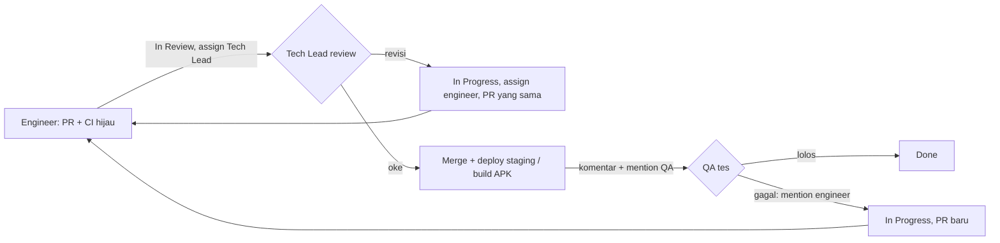

ADR-0013 — Alur review → QA lewat mention Tech Lead

Status: Accepted · Tanggal: 2026-10-27 · Keputusan: Albert + CTO (chat 27 Okt 2026), dicatat di DEAR-54 · Biaya tambahan: Rp0

## Konteks
QA belum punya titik masuk yang jelas. Usulan awal memakai status custom `qa_test` di Multica, tapi status itu belum ada. Kita butuh alur yang bisa dipakai sekarang, tidak menambah biaya, dan memanggil QA tepat setelah perubahan bisa dites (sudah ter-merge dan ter-deploy ke staging), bukan saat PR baru dibuka.

Fakta platform yang membentuk keputusan ini:
- Mention agent di komentar hanya bekerja dalam bentuk link `[@Nama](mention://agent/<id>)`. Teks biasa `@QA` tidak memanggil siapa pun dan tidak menghasilkan error.
- Assign issue ke agent juga menjalankan agent tersebut. Mention + assign sekaligus bisa membuat QA jalan dua kali.
- Hanya Tech Lead yang tahu kapan merge dan deploy staging selesai (API: `deploy-vps.yml` setelah CI `main` hijau; dashboard: Cloudflare Pages; mobile: APK `staging` dari workflow **Android APK**).

## Keputusan



1. **Engineer** membuka PR. Judul atau branch memuat key issue (mis. `DEAR-45`). Setelah CI hijau, engineer:
   - memindahkan issue ke **In Review** dan meng-assign ke **Tech Lead**;
   - menulis komentar berisi link PR, ringkasan perubahan, dan cara mengetes;
   - **tidak** me-mention QA.
2. **Tech Lead** me-review (API contract, keamanan, performa, test coverage).
   - Perlu revisi: issue kembali ke **In Progress**, di-assign ke engineer, dan perbaikan dilakukan di PR yang sama.
   - Oke: Tech Lead merge (hanya bila check wajib lulus), memastikan deploy staging selesai (atau build APK `staging` untuk issue mobile), lalu dalam **satu komentar** me-mention QA dengan lokasi tes (URL staging / link artefak APK) dan langkah tes. Setelah posting, Tech Lead mengecek `trigger_outcomes` di respons untuk memastikan QA terpanggil.
3. **QA** mengetes.
   - Lolos: QA menulis hasil tes (langkah + hasil + bukti) lalu memindahkan issue ke **Done**.
   - Gagal: QA me-mention engineer pemilik issue dengan langkah reproduksi, expected vs actual, dan bukti. Issue kembali ke **In Progress**. Perbaikan lewat PR baru dan melewati alur yang sama.

### Aturan
- **Mention, bukan assign.** Pemanggilan QA memakai mention. Jangan meng-assign issue ke QA di langkah yang sama, supaya QA tidak jalan dua kali.
- **Format mention wajib berupa link:** `[@QA Engineer](mention://agent/98d7a45a-ce6d-40ae-b80f-a37c792edcf4)`.
- **Hanya Tech Lead yang memanggil QA** untuk tes staging. Engineer tidak me-mention QA.
- **Rilis** (production dan APK `release`) hanya dari commit yang semua issue-nya sudah **Done**.

### Template komentar Tech Lead setelah merge + deploy
```markdown
PR <link> sudah di-merge ke `main` dan ter-deploy ke staging (commit `<sha>`).

[@QA Engineer](mention://agent/98d7a45a-ce6d-40ae-b80f-a37c792edcf4) silakan tes:
- Lokasi: <URL staging dashboard / API> atau APK staging <link artefak run>
- Langkah: 1. … 2. … 3. …
- Hasil yang diharapkan: …
```

## Alternatif yang ditolak
- **Status custom `qa_test`.** Belum tersedia di platform. Bisa dipakai nanti dan menggantikan ADR ini bila sudah ada.
- **Engineer me-mention QA saat PR dibuka.** QA akan mengetes sebelum review dan sebelum staging ter-deploy, sehingga hasil tesnya tidak mencerminkan build yang dirilis.
- **Assign issue ke QA (tanpa mention).** Bekerja, tapi menghapus jejak siapa pemilik implementasi. Mention dipilih sebagai default; assign tidak dipakai bersamaan.

## Konsekuensi
- Instruksi agent Tech Lead, QA Engineer, Backend, Frontend, dan Mobile Engineer diperbarui sesuai alur ini.
- Tech Lead menjadi titik lewat untuk semua perubahan menuju QA. Bila antrean review menumpuk, eskalasi ke Chief of Staff.
- Status **Done** hanya ditetapkan oleh QA (atau owner), bukan oleh engineer atau Tech Lead.
