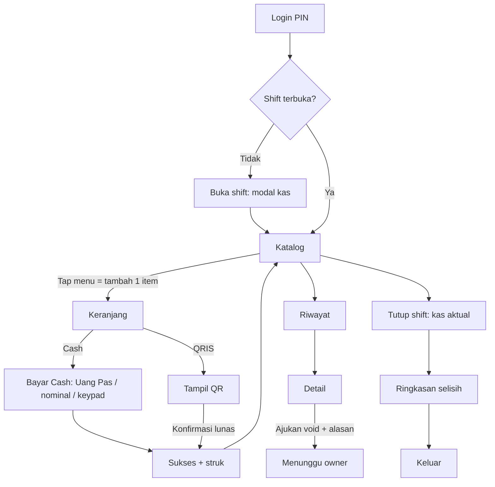

## User flow

Owner: login → Produk → Tambah (nama, kategori, harga, foto) → Simpan → sinkron ke kasir ≤1 menit; Shift & Kas → pilih shift → lihat selisih → buka transaksi shift; Void → Setujui/Tolak.

## Sitemap

- Kasir: K-01 Login PIN · K-02 Buka shift · K-04 Katalog+keranjang · K-06 Cash · K-07 QRIS · K-08 Sukses/struk (+K-08b/c error cetak) · K-10b Detail+cetak ulang · K-12/12b/12c Printer struk (Bluetooth: pindai, terhubung, terputus) · K-09 Riwayat · K-10 Detail+void · K-11 Tutup shift · status: loading/kosong/error/offline.
- Owner: Login · Dashboard · Transaksi (+detail) · Produk (list/form/kategori) · Pegawai · Shift & Kas · Void · Laporan (Should) · Pengaturan toko.

## Design system

- Warna: hijau daun `#15803D` (primer, putih di atasnya 5.0:1), oranye jeruk `#C2410C` (aksen/harga, 5.2:1 di putih), krem `#FFFBF2` latar, teks `#1C2A1F`, muted `#566456`, bahaya `#B91C1C`, peringatan `#92400E`/`#FEF3C7`, info `#1D4ED8`. Status tak pernah hanya warna (selalu teks/ikon).
- Tipografi: Inter (fallback system-ui). 12/14/16/20/28; harga & angka `tabular-nums`; angka kembalian/total 40px.
- Spacing 4/8/12/16/24/32; radius 8/12/20; target sentuh ≥48px (aksi utama 56–72px).
- Komponen: lihat `design.css` (btn, chip, badge status, pcard, cart line, keypad, field/input, table, kpi card, banner, skeleton, sheet).
- Breakpoint: kasir HP-first (360–430px: katalog 2 kolom, bar bayar Cash/QRIS di bawah); tablet opsional ≥900 (4 kolom + keranjang 340px); owner ≥1024 sidebar, <768 bottom-tab.

## Hitungan tap (jalur favorit, cash, uang pas)

1 tap kartu menu → 2 tap Cash → 3 tap Uang Pas → struk = 3 tap. Tanpa opsi/varian. Lulus ≤4.

**Keputusan (Albert): tidak ada opsi/varian produk** (ukuran, gula, es, topping). Satu produk = satu harga. Dampak API: tidak perlu entitas varian/modifier.

**Cetak struk (Albert):** toggle “Cetak struk” ada di layar Cash dan QRIS (default aktif, diingat per perangkat; tetap 3 tap). Pegawai menyambungkan printer thermal Bluetooth ESC/POS 58 mm di K-12 (Shift → Printer struk): pindai, hubungkan, cetak tes, auto-reconnect. Dampak Mobile: izin Bluetooth, penyimpanan printer terakhir lokal, format struk ESC/POS. Header/footer struk bisa diatur owner di Pengaturan toko (usulan).

**Desain printer (DEAR-20):** tema gelap `kasir.html` bagian D memuat toggle “Cetak struk” (K-06/K-07, 4 state), layar Printer K-12 (pindai/terhubung/terputus + cetak tes), banner error cetak (tidak tersambung, kertas habis, gagal cetak; transaksi tetap tersimpan), “Cetak ulang” di sukses/detail/riwayat, dan pratinjau struk 58 mm (32 kolom) dengan header/footer dari Pengaturan toko. Asumsi: 1 percobaan cetak otomatis lalu banner; cetak ulang tersedia selain status Dibatalkan; satu banner error tampil sekaligus di aplikasi. Komponen baru di akhir `design.css`: `.ptoggle .switch .dot .dev .pbanner .paper .pill`.

## Dashboard owner: Arah A · Jus Hangat (DEAR-40)

Spesifikasi lengkap ada di `owner.html` (DEAR-63). Implementasi bertahap di branch `redesign/owner-dashboard`: token, komponen dasar, dan AppShell (DEAR-64); Ringkasan, Transaksi, Shift (DEAR-65); halaman lain (DEAR-66).

**Halaman DEAR-66 (selaras `owner.html` §4–§5):**

- Login: dua kolom di desktop (hero + kartu form), satu kolom di HP. Ikon mata untuk tampil/sembunyi kata sandi, galat di kartu `role="alert"`, tombol "Memeriksa…".
- Produk & Kategori: cari + filter, kartu produk dengan badge ikon + teks, kategori sebagai kartu di kanan (desktop) atau di bawah daftar (HP). Hapus selalu lewat dialog konfirmasi.
- Pegawai: avatar inisial, badge Aktif/Nonaktif, Nonaktifkan lewat dialog konfirmasi, kartu info soal PIN.
- Perangkat: badge Terhubung / Menunggu pairing / Dicabut, kode pairing besar (34px/900, jarak huruf 0,2em), Cabut lewat dialog danger.
- Pengaturan: tiga kartu (Toko, Struk, QRIS statis), pratinjau struk menempel di kanan (desktop), bar Simpan menempel di bawah (HP).
- Persetujuan batal: kartu per permintaan (dua kolom di desktop), tab Menunggu/Disetujui/Ditolak, dialog konfirmasi. Istilah "void" diganti "batal" hanya di teks UI; API dan nama route tetap `void`.

**Komponen bersama yang ditambah:** `ConfirmDialog` (konfirmasi aksi merusak, sheet di HP), `Field` prop `trailing`, `PageHeader` prop `subtitle` (`apps/dashboard/src/components/ui.tsx`). Token `--gradient-hero` di `styles.css`.

**Selisih dari spesifikasi:** di HP, aksi baris Produk/Pegawai tampil langsung sebagai tombol (bukan bottom sheet setelah mengetuk baris), dan kelola kategori tampil sebagai kartu di bawah daftar (bukan ikon sliders + sheet). Fungsi sama; bisa dirapikan jika desainer menghendaki sheet.
