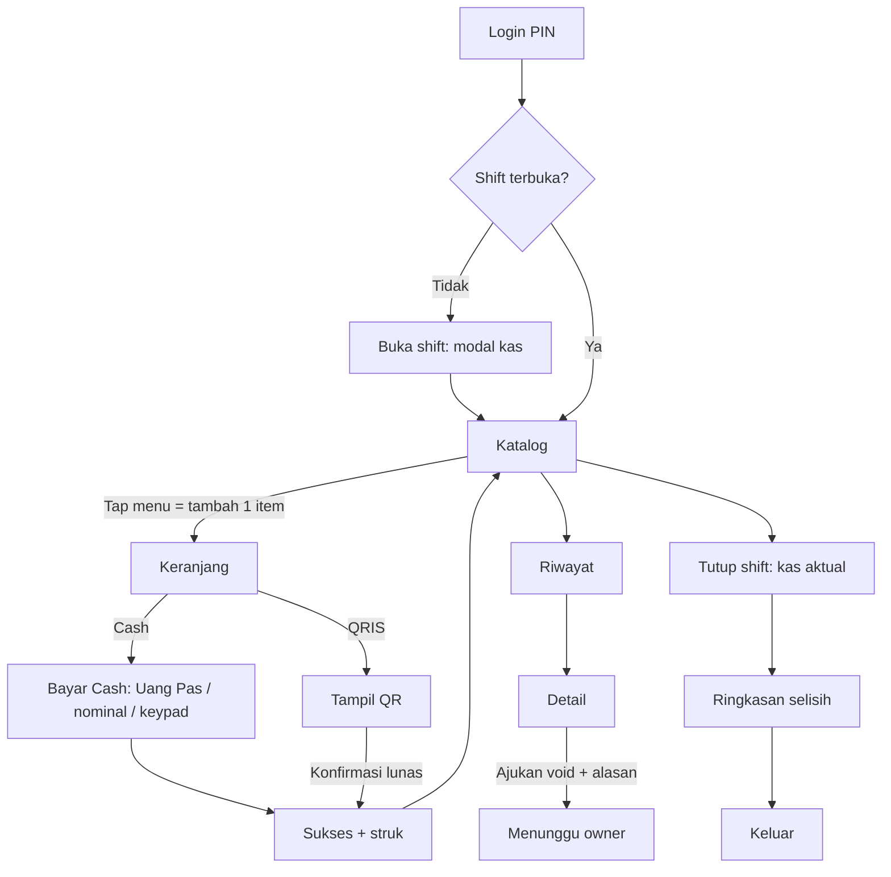

## User flow

Owner: login → Produk → Tambah (nama, kategori, harga, foto) → Simpan → sinkron ke kasir ≤1 menit; Shift & Kas → pilih shift → lihat selisih → buka transaksi shift; Void → Setujui/Tolak.

## Sitemap
- Kasir: K-01 Login PIN · K-02 Buka shift · K-04 Katalog+keranjang · K-06 Cash · K-07 QRIS · K-08 Sukses/struk · K-12 Printer struk (Bluetooth) · K-09 Riwayat · K-10 Detail+void · K-11 Tutup shift · status: loading/kosong/error/offline.
- Owner: Login · Dashboard · Transaksi (+detail) · Produk (list/form/kategori) · Pegawai · Shift & Kas · Void · Laporan (Should) · Pengaturan toko.

## Design system
- Warna: hijau daun `#15803D` (primer, putih di atasnya 5.0:1), oranye jeruk `#C2410C` (aksen/harga, 5.2:1 di putih), krem `#FFFBF2` latar, teks `#1C2A1F`, muted `#566456`, bahaya `#B91C1C`, peringatan `#92400E`/`#FEF3C7`, info `#1D4ED8`. Status tak pernah hanya warna (selalu teks/ikon).
- Tipografi: Inter (fallback system-ui). 12/14/16/20/28; harga & angka `tabular-nums`; angka kembalian/total 40px.
- Spacing 4/8/12/16/24/32; radius 8/12/20; target sentuh ≥48px (aksi utama 56–72px).
- Komponen: lihat `design.css` (btn, chip, badge status, pcard, cart line, keypad, field/input, table, kpi card, banner, skeleton, sheet).
- Breakpoint: kasir HP-first (360–430px: katalog 2 kolom, bar bayar Cash/QRIS di bawah); tablet opsional ≥900 (4 kolom + keranjang 340px); owner ≥1024 sidebar, <768 bottom-tab.

## Hitungan tap (jalur favorit, cash, uang pas)
1 tap kartu menu → 2 tap Cash → 3 tap Uang Pas → struk = 3 tap. Tanpa opsi/varian. Lulus ≤4.

**Keputusan (Albert): tidak ada opsi/varian produk** (ukuran, gula, es, topping). Satu produk = satu harga. Dampak API: tidak perlu entitas varian/modifier.

**Cetak struk (Albert):** toggle “Cetak struk” ada di layar Cash dan QRIS (default aktif, diingat per perangkat; tetap 3 tap). Pegawai menyambungkan printer thermal Bluetooth ESC/POS 58 mm di K-12 (Shift → Printer struk): pindai, hubungkan, cetak tes, auto-reconnect. Dampak Mobile: izin Bluetooth, penyimpanan printer terakhir lokal, format struk ESC/POS. Header/footer struk bisa diatur owner di Pengaturan toko (usulan).
