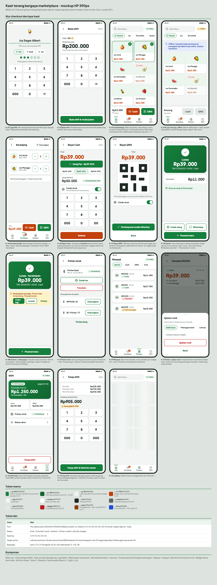

# Riset dan redesign kasir mobile: tema terang bergaya marketplace (DEAR-60)

Tahap riset dan mockup saja. Kode `apps/kasir` tidak diubah. Mockup: `kasir-light.html` (interaktif dibuka di browser) dan `kasir-light.png` (semua layar, 390px). Token dan komponen: `kasir-light.css`.

## 1. Audit layar kasir sekarang

Audit dilakukan dari kode `apps/kasir` (`src/theme.ts`, `app/*.tsx`, `app/(tabs)/*.tsx`) dan mockup gelap `docs/design/kasir.html`. Aplikasi tidak dijalankan di sesi ini, jadi tidak ada screenshot aplikasi hidup. Catatan di bawah berasal dari struktur dan gaya di kode.

| Layar | Berkas | Yang terasa kaku |
| --- | --- | --- |
| Login PIN | `login.tsx` | Emoji 🍹 sebagai logo, daftar nama berupa chip teks tanpa avatar. Layar hitam-hijau satu massa. |
| Buka shift | `open-shift.tsx` | Fungsi sudah baik (prefill modal kas). Angka besar di atas latar gelap tanpa pemisah kartu. |
| Jual (katalog) | `(tabs)/jual.tsx` | Pencarian berupa kolom teks biasa, chip "⭐ Favorit" berbasis emoji, kartu menu tanpa gambar (hanya teks nama + harga), ikon tab memakai emoji (🍹🛒🧾⏱) sehingga tampilannya beda per OS. |
| Keranjang | `(tabs)/keranjang.tsx` | Baris teks dengan tombol "−/+/Hapus" berlabel teks, tanpa thumbnail. |
| Bayar Cash | `cash.tsx` | Urutan sudah bagus (Uang Pas paling atas). Total oranye di latar gelap kontrasnya baik, tetapi kotak "Uang diterima" dan keypad menyatu dengan latar. |
| Bayar QRIS | `qris.tsx` | QR perlu latar putih; di tema gelap QR tampak "tertempel". |
| Sukses/struk | `success.tsx` | ✅ emoji besar, kembalian hanya teks. Banner cetak sudah ada (`PrintBanner`). |
| Printer | `printer.tsx` | Daftar perangkat fungsional, gaya sama dengan layar lain (tidak ada kartu perangkat yang jelas). |
| Riwayat | `(tabs)/riwayat.tsx` | Nomor transaksi panjang jadi judul, metode bayar hanya teks. |
| Detail + void | `transaction/[id].tsx` | Form void dalam layar penuh. |
| Tutup shift | `close-shift.tsx` | Ringkasan berupa baris label-nilai; selisih bisa lebih menonjol. |

### Titik kaku (ringkas)

1. Tema gelap satu warna: kartu `#18221D` hampir sama dengan latar `#0E1512`, tidak ada hierarki.
2. Ikon tab dan penanda berupa emoji campur, tidak konsisten.
3. Kartu menu tanpa gambar atau pembeda visual, jadi memindai menu mengandalkan membaca.
4. Tidak ada bilah cari yang jelas di atas dan chip kategori tidak menonjol.
5. Hierarki aksi: Cash (oranye) dan QRIS (hijau) bagus, tetapi sisanya semua tombol bergaris sama.
6. Form (void, tutup shift) di layar penuh padahal cukup bottom sheet.

### Yang dipertahankan

- Jalur 3 tap, "Uang Pas" tombol utama, bilah bayar menempel, tab Keranjang berlencana (DEAR-49).
- Target sentuh ≥48px (56 aksi utama, 60 keypad), angka `tabular-nums`.
- Status = ikon + teks (Lunas, Offline, Tersambung, Kurang).
- Fungsi printer Bluetooth dan offline-first (outbox), banner offline dan banner error cetak.

## 2. Acuan dan pola yang diambil

Catatan kejujuran: benchmark berasal dari pengetahuan umum tentang produk, belum diverifikasi lewat penjelajahan langsung di sesi ini. Pola diambil, bukan aset: tidak memakai logo, ikon, ilustrasi, atau nama merek Tokopedia.

| Acuan | Pola yang dipakai | Sumber |
| --- | --- | --- |
| Tokopedia (marketplace) | Latar abu-terang + kartu putih membulat, bilah cari di atas, chip kategori kapsul, kartu produk (gambar, nama, harga tebal), tab bawah berikon + lencana, bottom sheet untuk pilihan, hijau sebagai aksen utama | https://www.tokopedia.com |
| GoBiz | Mobile-first, bahasa Indonesia, angka penjualan utama di puncak | https://gobiz.co.id |
| Moka POS | Katalog kartu + keranjang menempel, bayar cepat | https://www.mokapos.com |
| Loyverse | Kepadatan rendah, warna jelas per fungsi untuk kasir warung | https://loyverse.com |

### Terjemahan ke konteks kasir (marketplace untuk menjelajah, kasir untuk mencatat cepat)

| Pola marketplace | Di kasir | Alasan |
| --- | --- | --- |
| Bilah cari besar sebagai pusat layar | Bilah cari di atas, 48px, tidak dipaksa fokus (keyboard tidak muncul sendiri) | Kasir lebih sering memilih dari favorit daripada mencari |
| Kartu produk dengan foto besar, rating, toko | Foto kecil/emoji + nama + harga; tanpa rating, tanpa ulasan | Kecepatan; produk tidak punya varian (keputusan Albert) |
| Tap kartu membuka halaman produk | **Tap kartu = langsung +1** (tidak berubah) | Menjaga 1 tap per item |
| Tombol "Beli Langsung" / "+ Keranjang" | Bilah bayar menempel dengan Cash / QRIS | Jalur checkout sudah paling pendek |
| Banner promo, rekomendasi, beranda panjang | Tidak dipakai | Mengurangi kebisingan di konter |
| Bottom sheet untuk filter/pilihan | Dipakai untuk void dan konfirmasi; riwayat memakai chip, bukan dropdown | Layar penuh tidak perlu untuk 1 keputusan |
| Hijau + putih | Hijau jus yang sudah ada `#15803D`, bukan hijau persis Tokopedia | Sesuai asumsi issue |

## 3. Arah desain

- **Terang**: latar `#F2F5F3`, kartu putih bayangan lembut, radius 16/24, kapsul untuk chip dan badge.
- **Satu warna aksi utama per konteks**: hijau = lanjut/selesai/QRIS, oranye = uang tunai/harga, merah bergaris = void/tutup shift.
- **Ikon Lucide satu set**, tanpa emoji untuk fungsi. Emoji hanya sebagai gambar placeholder produk dan sapaan.
- **Status**: selalu ikon + teks. Warna hanya penguat.
- **Hero hijau di Sukses dan Shift**: angka utama (Lunas Rp39.000, penjualan hari ini) diberi panggung.
- **Tipografi**: Plus Jakarta Sans (sudah dipakai di `docs/design/design.css`), 12/14/16/18/22/28/40.

### Token

Daftar lengkap ada di `kasir-light.html` dan `kasir-light.css`. Ringkas:

| Token | Nilai | Catatan kontras (dihitung WCAG) |
| --- | --- | --- |
| `--g-600` | `#15803D` | putih di atasnya 5,0:1 |
| `--g-700` / `--g-50` | `#116530` / `#EAF6EE` | 6,5:1 |
| `--or-700` | `#C2410C` | di putih 5,2:1 (harga, Cash) |
| `--ink` / `--muted` | `#1F2A24` / `#5A675F` | di putih 14,8 / 5,9; muted di `--bg` 5,4 |
| `--danger` | `#B91C1C` | di putih 6,5; di `#FDECEA` 5,7 |
| `--warn` | `#92400E` di `#FEF3C7` | 6,4 |
| `--info` | `#1D4ED8` di `#E4ECFD` | 5,6 |

Semua teks ≥4,5:1. Pengecualian yang perlu dicek di perangkat: tombol nonaktif (`#5A675F` di `#E3E8E5` 4,8:1, lolos).

Radius: 8 / 12 / 16 / 24 / pill. Spasi: 4/8/12/16/24/32. Target sentuh 48 (chip 40 tinggi + `hitSlop` 4), aksi utama 56, keypad 60.

### Komponen

Bilah cari, chip, kartu produk (lencana qty, tag Habis), bilah bayar menempel, tab bawah berikon + lencana, tombol (primer/aksen/outline/ghost/bahaya), stepper, keypad, banner (info/peringatan/galat/ok), badge status, bottom sheet, switch, skeleton. Semua di `kasir-light.css`.

## 4. Jumlah tap checkout, sebelum vs sesudah

Jalur favorit, 1 item, tanpa opsi. Tap dihitung dari layar Jual dengan keranjang kosong sampai transaksi tersimpan (struk tercetak otomatis bila printer tersambung). "Pesanan baru" tidak dihitung, sama seperti sebelumnya.

| Langkah | Cash uang pas | | QRIS | |
| --- | --- | --- | --- | --- |
| | Sekarang | Sesudah | Sekarang | Sesudah |
| 1. Tap kartu menu | 1 | 1 | 1 | 1 |
| 2. Tap Cash / QRIS di bilah bayar | 2 | 2 | 2 | 2 |
| 3. Uang Pas / Pembayaran sudah diterima | 3 | 3 | 3 | 3 |
| **Total** | **3** | **3** | **3** | **3** |
| Cash dengan nominal cepat | 4 (chip + Selesai) | 4 | | |
| Tambah 1 item lagi | +1 | +1 | +1 | +1 |

Hasil: **tidak bertambah**. Perubahan ini murni visual: posisi tombol dan urutan layar sama. Toggle "Cetak struk" tetap ada di Cash dan QRIS dan bukan tap wajib.

## 5. Layar dalam mockup

K-01 login PIN · K-02 buka shift · K-04 jual · K-04b jual kosong + offline · K-05 keranjang · K-06 Cash · K-07 QRIS · K-08 sukses · K-08b sukses + gagal cetak · K-12 printer · K-09 riwayat · K-10 detail + bottom sheet void · K-11a tab shift · K-11 tutup shift · K-13 loading (skeleton).

## 6. Asumsi dan keputusan terbuka (perlu konfirmasi Albert)

1. **Tema terang menggantikan tema gelap.** Alasan gelap dulu: dipakai pegawai di konter dan hemat daya OLED. Risiko: silau di malam hari dan kontras layar di bawah cahaya kedai belum diuji. Rekomendasi: terang jadi default, tambahkan opsi tema gelap di Pengaturan (token gelap sudah ada) bila pegawai meminta.
2. Aksen hijau memakai `#15803D` yang sudah dipakai kasir, bukan hijau Tokopedia. Tidak ada aset Tokopedia.
3. Foto produk opsional: bila belum ada foto, tampil emoji/inisial pada kotak `--g-50`. Perlu dicek apakah API produk mengirim `image_url`.
4. Font Plus Jakarta Sans harus dibundel (`@expo-google-fonts/plus-jakarta-sans`) atau fallback ke font sistem. Menambah ukuran aplikasi kecil.
5. Ikon Lucide via `lucide-react-native` (butuh `react-native-svg`, kemungkinan sudah ada karena QR).
6. Nama toko pada login memakai nama dari pairing (contoh mockup: "Jus Segar Albert").
7. Implementasi Mobile baru setelah rilis MVP (DEAR-19) live, sama seperti DEAR-40.

## 7. Perkiraan usaha Mobile

Sekitar 3–4 hari, tanpa perubahan API: token `src/theme.ts` (0,5), komponen `src/ui/components.tsx` + ikon (1), layar Jual/Keranjang/Riwayat (1), sheet void dan layar sisanya (1), pembaruan test yang mencari teks/emoji lama (0,5).

## 8. Cara verifikasi

Buka `docs/design/research/kasir-tokopedia/kasir-light.html` di browser (lebar ≥1700px) atau lihat `kasir-light.png`. Rasio kontras dapat dihitung ulang dari token di atas.
