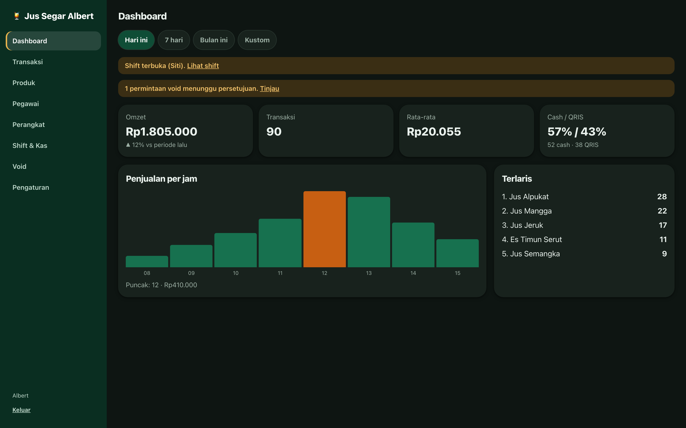
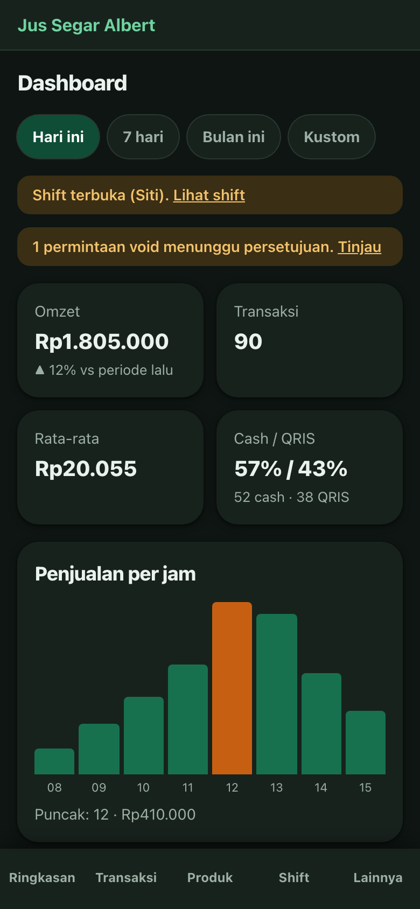
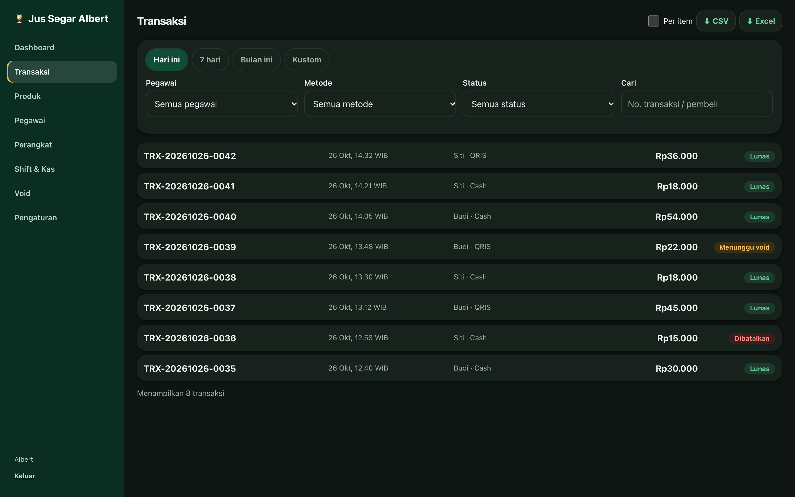
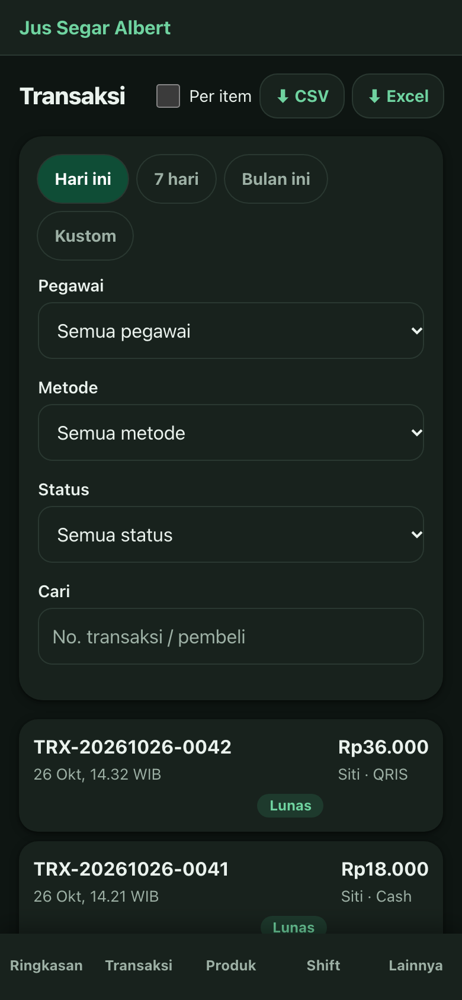
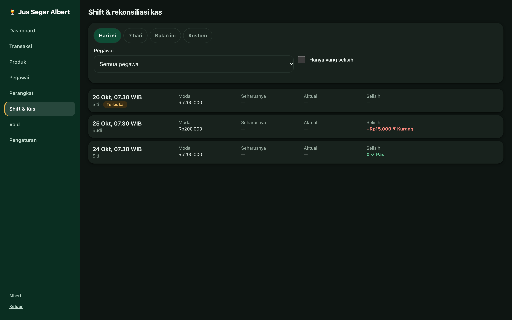
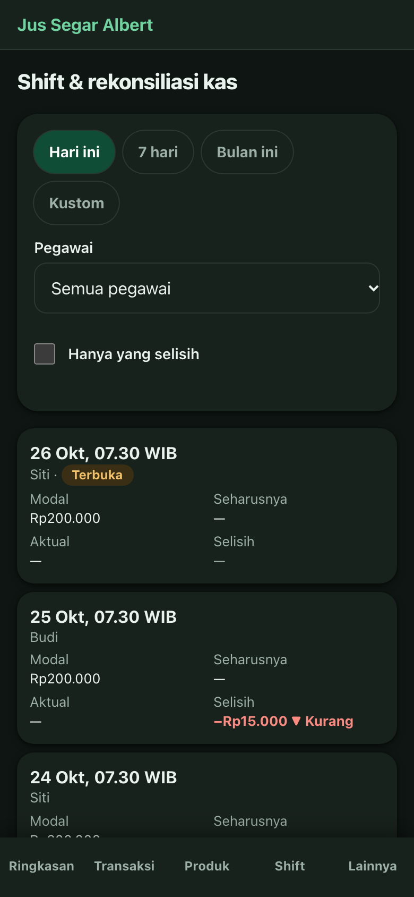
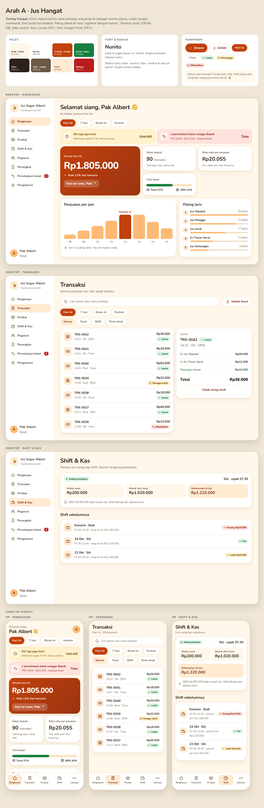
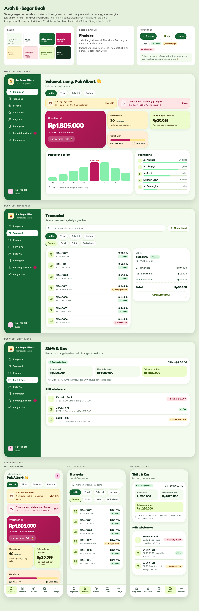
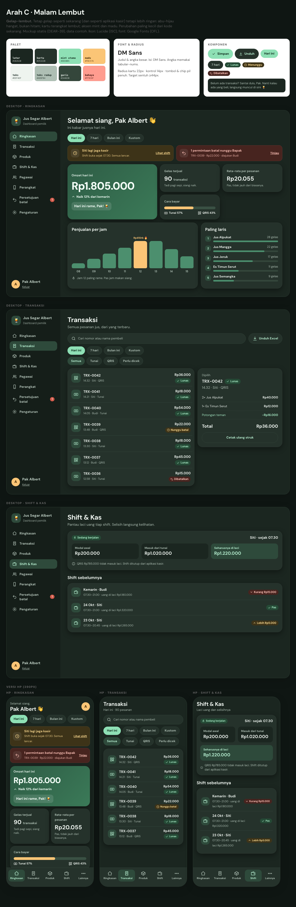

# Riset UI dashboard owner: ramah dan tidak kaku (DEAR-39)

Tahap riset dan mockup saja. Kode `apps/dashboard` tidak diubah. Pengguna: Albert, pemilik satu gerai jus, sering membuka dari HP dan hanya ingin tahu "hari ini gimana".

## 1. Audit UI sekarang

Screenshot diambil dari `pnpm --filter @kelola-kasir/dashboard dev:mock` di 1440px dan 390px. Prism mock hanya mengembalikan placeholder `"string"`, jadi respons `/v1/*` diganti data contoh jus lewat Playwright (`page.route`). Tampilan dan komponennya tetap yang asli.

| Halaman | Desktop 1440 | HP 390 |
| --- | --- | --- |
| Ringkasan |  |  |
| Transaksi |  |  |
| Shift & Kas |  |  |

### Yang membuatnya terasa kaku

1. **Hitam-hijau pekat dan satu warna.** Latar `#0E1512` dengan kartu `#18221D` hampir tidak berbeda. Kartu tidak "terangkat", semuanya satu massa gelap. Hijau tua `#0F4D36` di tombol dan chip aktif nyaris hilang di latar gelap. Kesan "ruang kontrol", bukan kedai jus.
2. **Tidak ada ikon di navigasi.** Sidebar dan tab bawah HP hanya teks. Tab "Lainnya" tidak memberi petunjuk isinya. Tidak ada tanda visual yang membantu mengenali menu sekilas.
3. **Hierarki datar.** Empat KPI sama besar (`Omzet`, `Transaksi`, `Rata-rata`, `Cash / QRIS`). Padahal Albert hanya butuh satu angka: omzet hari ini. Omzet tidak diberi panggung.
4. **Copywriting seperti laporan akuntansi.** "Transaksi 90", "Rata-rata", "Cash / QRIS 57% / 43%", "Shift terbuka (Siti)". Tidak ada sapaan, konteks, atau kesimpulan ("rame / sepi", "naik dari kemarin").
5. **Peringatan terlihat seperti error.** Dua banner kuning memanjang di atas KPI. "Shift terbuka" sebenarnya kabar biasa, bukan peringatan, tetapi diberi gaya yang sama dengan "void menunggu persetujuan" yang memang butuh tindakan. Keduanya menutupi angka utama.
6. **Filter memakan layar HP.** Di Transaksi (390px), tombol ekspor, chip tanggal, tiga dropdown dan kolom cari mengisi hampir seluruh layar pertama. Daftar transaksi baru terlihat setelah scroll. Pengguna "waktunya sempit" paling dirugikan di sini.
7. **Daftar transaksi padat teks.** Nomor panjang `TRX-20261026-0042` jadi judul baris, jam ditulis "26 Okt, 14.32 WIB", dan badge jatuh ke baris ketiga di HP. Tidak ada ikon metode bayar, jadi harus membaca teks "Cash/QRIS".
8. **Grafik kurang bercerita.** Batang tanpa nilai di sumbu, puncak hanya ditandai warna oranye, dan keterangannya "Puncak: 12 · Rp410.000" kecil di bawah. "Terlaris" adalah daftar angka tanpa konteks satuan atau proporsi.
9. **Tombol dan chip tidak punya hirarki.** Chip tanggal, tombol "⬇ CSV", dan "Excel" memakai gaya sama (kapsul gelap berbingkai). Aksi utama tidak menonjol.
10. **Ikon memakai emoji campur karakter unicode** (`⬇`, `▲`, `▼`, `✓`). Gayanya tidak konsisten, dan tampilannya beda di tiap OS.
11. **Empty state dan sambutan minim.** Empty state hanya ikon emoji dan satu baris judul tanpa ajakan atau nada santai.

### Yang sudah bagus (dipertahankan)

- Status tidak hanya warna: selisih shift memakai tanda +/−, ikon dan teks ("Pas / Kurang / Lebih"). Pola ini dibawa ke semua arah.
- Target sentuh besar (≥48px), angka `tabular-nums`, peran ARIA pada grafik.
- Identitas jus: 🍹, hijau daun, aksen jeruk, Plus Jakarta Sans.

## 2. Benchmark

Catatan kejujuran: benchmark disusun dari pengetahuan umum tentang produk-produk ini dan halaman publiknya, belum diverifikasi ulang lewat penjelajahan langsung pada sesi ini. Tautan di bawah adalah halaman resmi untuk dicek ulang bila perlu.

| Produk | Yang ramah dan bisa dipakai | Sumber |
| --- | --- | --- |
| Square Dashboard | Satu angka penjualan besar di atas, ringkasan per hari dalam kartu, bahasa singkat dan jelas. | https://squareup.com/us/en/point-of-sale/dashboard |
| Shopify admin (Polaris) | Kartu bersih, badge status dengan ikon + teks, empty state yang selalu memberi ajakan. | https://polaris.shopify.com |
| Loyverse | Kepadatan rendah, warna jelas per fungsi, cocok untuk pemilik warung. | https://loyverse.com |
| GoBiz (Gojek) | Mobile-first: ringkasan pendapatan hari ini di puncak layar, bahasa percakapan Indonesia. | https://gobiz.co.id |
| Moka / Majoo | Bahasa lokal, laporan penjualan dipecah ke kartu yang bisa diketuk. | https://www.mokapos.com · https://majoo.id |
| Stripe Dashboard | Angka besar bertinggi hierarki, grafik tenang, ruang kosong lega. | https://stripe.com/docs/dashboard/basics |
| Notion | Warna hangat netral, ikon/emoji sebagai identitas, sudut halus, kata-kata santai. | https://www.notion.so |
| Linear | Kerapian dan kecepatan; tidak ramah di sisi warna, dipakai sebagai acuan kerapian dan keyboard-first, bukan nuansa. | https://linear.app |
| Duolingo | Warna jenuh dan ceria, maskot, umpan balik berupa kalimat penyemangat, sudut sangat bulat. | https://design.duolingo.com |
| Airbnb | Foto/ilustrasi besar, kartu membulat, tipografi hangat, sedikit elemen per layar. | https://www.airbnb.com |
| Aplikasi fintech Indonesia (Jago, GoPay, DANA, BCA mobile) | Saldo/angka utama besar di kartu berwarna, akses cepat ikon bulat, sapaan "Halo, …", tab bawah berikon. | https://jago.com · https://www.gopay.co.id |

### Pola yang diambil

1. **Satu angka pahlawan** berukuran besar di kartu berwarna (Square, Stripe, fintech). Omzet hari ini jadi kartu terbesar.
2. **Sapaan + kesimpulan satu kalimat** ("Hari ini rame, Pak!") (GoBiz, Duolingo, Notion).
3. **Kartu membulat 24–28px, bayangan lembut** (Airbnb, Duolingo).
4. **Badge dengan ikon + teks pendek** (Polaris).
5. **Tab bawah berikon + label** dan kartu menyatu dengan latar (fintech).
6. **Empty state yang mengajak dan santai** (Polaris, Notion).
7. **Warna fungsional per jenis kartu** (Loyverse, Duolingo): cukup hangat tanpa membuat semuanya berwarna.
8. **Mikro-interaksi** untuk tahap implementasi: bar tumbuh saat masuk, angka omzet menghitung naik, chip tekan membal ringan (hormati `prefers-reduced-motion`).

## 3. Prinsip desain baru

1. **Satu hal besar per layar.** Pagi: omzet hari ini. Jangan menyaingi dengan 4 kartu sama besar.
2. **Bicara seperti teman, bukan laporan.** Sapaan, kesimpulan, kata kerja. Tetap pendek dan jelas.
3. **Hangat dan membulat.** Kartu 22–28px, kontrol 14–18px, tombol dan chip berbentuk pil. Latar tidak hitam murni.
4. **Pisahkan kabar dari tugas.** Informasi (shift berjalan) memakai kartu hangat tenang. Yang butuh tindakan (void menunggu) memakai warna dan ajakan yang jelas, hanya satu per tindakan.
5. **Ikon konsisten, bukan emoji campur.** Satu set ikon garis (Lucide). Emoji 🍹🔥 hanya di sapaan dan penanda, bukan fungsi.
6. **Status tidak hanya warna.** Badge selalu ikon + teks ("✓ Lunas", "▼ Kurang Rp15.000"). Kontras ≥4,5:1 untuk teks.
7. **HP dulu, jari jempol dulu.** Filter di balik satu chip/bottom sheet. Daftar muncul di layar pertama. Target sentuh ≥44px.

### Tone copywriting (Bahasa Indonesia)

| Sekarang | Baru |
| --- | --- |
| Dashboard | Selamat siang, Pak Albert 👋 |
| Total transaksi: 90 | 90 gelas terjual hari ini. Hari ini rame, Pak! 🍹 |
| Rata-rata | Rata-rata per pesanan |
| Cash / QRIS 57% / 43% | Tunai 57% · QRIS 43% (bar dua warna) |
| Shift terbuka (Siti). Lihat shift | Siti lagi jaga kasir sejak 07.30. Semua lancar. |
| 1 permintaan void menunggu persetujuan. Tinjau | 1 permintaan batal nunggu Bapak · Tinjau |
| Puncak: 12 · Rp410.000 | Jam 12 paling rame. Pas jam makan siang. |
| Belum ada penjualan | Belum ada yang beli. Santai dulu, Pak. Nanti langsung muncul di sini 🍹 |
| Gagal memuat ringkasan. Coba lagi | Waduh, ringkasannya belum kebuka. Coba lagi ya |
| Selisih −15.000 ▼ Kurang | ▼ Kurang Rp15.000 |
| Void | Persetujuan batal (istilah "void" diganti "batal" di UI owner) |

Aturan: panggil "Pak" (asumsi: pemilik laki-laki, sesuai contoh dari Albert; untuk pemilik lain gunakan nama dari profil). Tidak bercanda saat masalah uang: pesan selisih, galat, dan batal tetap lugas, hanya tanpa jargon.

## 4. Tiga arah gaya visual

Setiap mockup memuat Ringkasan, Transaksi, Shift & Kas (desktop 1264px dan HP 390px), palet, font, radius dan contoh komponen. Ikon Lucide (ISC), font Google Fonts (OFL). Gambar penuh ada di PNG masing-masing.

| Arah | File | Gaya | Font | Radius |
| --- | --- | --- | --- | --- |
| A · Jus Hangat | `owner-direction-a.html` | Terang-hangat: krem + oranye jeruk | Nunito | 24 / 14 |
| B · Segar Buah | `owner-direction-b.html` | Terang-segar: putih daun, kartu warna buah, hijau + semangka | Fredoka + Plus Jakarta Sans | 28 / 18 |
| C · Malam Lembut | `owner-direction-c.html` | Gelap-lembut: abu-hijau hangat, mint + madu | DM Sans | 22 / 14 |

### Aksesibilitas (rasio kontras dihitung WCAG)

Semua teks ≥4,5:1. Contoh: A teks muted/krem 6,3, putih/oranye utama 5,2; B putih/hijau 7,1, putih/semangka 6,0, muted/latar 6,1; C muted/kartu 7,0, teks gelap/mint 9,9, teks/hero terendah 5,0. Badge selalu berikon + teks. Fokus keyboard tetap diberi outline 3px (tidak digambar di mockup statis).

### Perbandingan

| | A Jus Hangat | B Segar Buah | C Malam Lembut |
| --- | --- | --- | --- |
| Ramah dan tidak kaku | ★★★★☆ | ★★★★★ | ★★★☆☆ |
| Cocok dibuka HP siang hari | ★★★★★ | ★★★★★ | ★★★☆☆ (malam enak) |
| Konsisten dengan aplikasi kasir (gelap) | ★★☆☆☆ | ★★☆☆☆ | ★★★★★ |
| Risiko ramai/berlebihan | rendah | sedang (banyak warna) | rendah |
| Usaha Frontend | token + sedikit layout | token + layout + varian kartu | token saja |

## 5. Rekomendasi

**Pilih Arah A (Jus Hangat).**

Alasannya: Albert membuka dashboard dari HP di siang hari saat kedai buka, dan terang-hangat paling terbaca di bawah cahaya. Gayanya ramah tanpa ramai berlebihan seperti B, serta masih menyambung ke identitas jus (jeruk, 🍹) dan hijau daun sebagai aksen. Aplikasi kasir sengaja tetap gelap karena dipakai pegawai di konter. Dashboard owner adalah pengalaman yang berbeda, jadi tidak wajib seragam.

Opsi cadangan: jika Albert ingin tetap gelap, pilih C (hampir tanpa perubahan layout). Jika ingin paling ceria, pilih B.

### Perkiraan usaha Frontend untuk Arah A

Total sekitar 3–5 hari Frontend, tanpa perubahan API.

1. **Token saja (~0,5 hari):** ganti `@theme` di `apps/dashboard/src/styles.css` (warna, radius, font Nunito, bayangan), `color-scheme` jadi `light`.
2. **Komponen (~1–1,5 hari):** `ui.tsx` (Button pil, Card 24px, Badge dengan ikon, Alert → kartu info/butuh tindakan, EmptyState ramah), tambah paket ikon `lucide-react`.
3. **Layout (~1,5–2 hari):**
   - `AppShell`: sidebar terang berikon + lencana jumlah persetujuan, tab bawah berikon dengan tab aktif berlatar.
   - Ringkasan: kartu omzet besar, kartu "gelas terjual / rata-rata / cara bayar", banner info vs tindakan, sapaan.
   - Transaksi: baris dengan ikon metode, filter tersembunyi di bawah chip/bottom sheet di HP, panel detail di desktop.
   - Shift & Kas: kartu shift berjalan.
4. **Copywriting dan polesan (~0,5–1 hari):** tabel copy di atas, empty/error state, animasi ringan.
5. Perbarui test yang mencari teks lama (`reports.test.tsx` dll.) dan `docs/design/README.md`.

### Asumsi

- Panggilan "Pak Albert" memakai nama dari sesi login. Jika nama tidak tersedia, gunakan sapaan netral "Halo!".
- "Void" diganti "batal" hanya di teks UI owner. Istilah API/kontrak tidak berubah.
- Pernyataan seperti "naik 12% dari kemarin" memakai `compare_previous_period` yang sudah ada. Label "kemarin" benar hanya untuk filter "Hari ini"; untuk rentang lain gunakan "dari periode lalu".
- Kalimat kesimpulan ("rame / sepi") butuh aturan sederhana di Frontend (misalnya dibanding rata-rata 7 hari terakhir). Aturan dan ambang perlu disepakati.
- Data di mockup adalah contoh.
