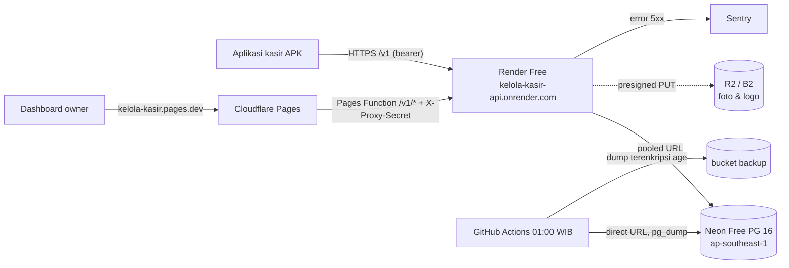

# Deploy free tier: Render + Neon + Cloudflare (DEAR-19)

Status: berlaku untuk MVP. Dasar keputusan: [ADR-0011](../adr/0011-free-tier-hosting.md). Operasional harian (deploy ulang, rollback, restore): [runbook.md](runbook.md). APK kasir: [apk-release.md](apk-release.md).

Semua akun dibuat **atas nama owner, tanpa kartu kredit**. Secret hanya diisi di dashboard platform (Render, Cloudflare) atau GitHub Actions secrets. Secret tidak boleh masuk repo, komentar issue, atau chat.

## Gambaran



| Komponen | Di repo | Platform |
|---|---|---|
| API | `apps/api/Dockerfile`, `render.yaml` (Blueprint) | Render Free, region Singapore |
| Migrasi DB | `node dist/db/migrate.js` di awal start container, lewat `DATABASE_URL_DIRECT` | Render Free **tidak punya pre-deploy command**, jadi migrasi jalan setiap start (idempoten) |
| Dashboard + proxy | `apps/dashboard` + `apps/dashboard/functions/v1/[[path]].ts` | Cloudflare Pages |
| Backup harian | `.github/workflows/backup.yml` + `ops/backup/` | GitHub Actions + R2/B2 |
| Uptime | `.github/workflows/uptime.yml` (per jam, 09:00–21:00 WIB) | GitHub Actions |
| Error | reporter ringan `apps/api/src/lib/error-reporter.ts` (aktif bila `SENTRY_DSN` diisi) | Sentry Developer (free) |
| APK | `.github/workflows/android-apk.yml` | GitHub Actions |

### Satu lingkungan: staging dulu, lalu produksi

Free tier cukup untuk **satu** lingkungan. Jam instance Render (750 jam/bulan) dan kuota Neon dipakai bersama, jadi lingkungan ini dipakai sebagai **staging selama UAT** (DEAR-18). Sebelum go-live, data direset (lihat [runbook § Reset data sebelum go-live](runbook.md#reset-data-sebelum-go-live)) lalu lingkungan yang sama menjadi produksi. URL tidak berubah.

## Checklist owner (sekali)

Kerjakan berurutan. Centang di komentar issue DEAR-19 setelah selesai, **tanpa** menempelkan nilai secret.

### 1. Neon (database)
- [ ] Daftar di neon.com (tanpa kartu). Buat project `kelola-kasir`: **Postgres 16** (wajib 16, sama dengan `pg_dump` di backup), region **AWS Asia Pacific (Singapore)**.
- [ ] Settings → Compute: ukuran tetap **0.25 CU** (min = max = 0.25) supaya 100 CU-jam/bulan cukup.
- [ ] Salin dua connection string dari Connect: **Pooled** (host berisi `-pooler`) dan **Direct**. Pastikan keduanya diakhiri `?sslmode=require`.
- [ ] Buat role khusus backup (SQL Editor, ganti password dengan yang dibuat password manager):
  ```sql
  CREATE ROLE backup_ro LOGIN PASSWORD '<password-acak>';
  GRANT pg_read_all_data TO backup_ro;
  ```
  URL backup = URL **Direct** dengan user/password `backup_ro`. Bila `GRANT` ditolak, sementara pakai role utama dan catat di issue.

### 2. Cloudflare R2 (foto + backup)
- [ ] Daftar Cloudflare. Buka R2. **Bila diminta metode pembayaran, berhenti, jangan tambahkan kartu**, lalu pakai Backblaze B2 (langkah 2b).
- [ ] Buat bucket `kelola-kasir-media` (foto/logo). Settings → Public access → aktifkan **r2.dev subdomain**; catat URL publiknya.
- [ ] Bucket `kelola-kasir-media` → Settings → CORS policy:
  ```json
  [{ "AllowedOrigins": ["https://kelola-kasir.pages.dev"], "AllowedMethods": ["PUT", "GET"], "AllowedHeaders": ["content-type"], "MaxAgeSeconds": 3600 }]
  ```
- [ ] Buat bucket `kelola-kasir-backup` (tanpa akses publik).
- [ ] R2 → Manage API tokens: token **Object Read & Write** khusus `kelola-kasir-media` (untuk API), dan token kedua khusus `kelola-kasir-backup` (untuk GitHub Actions). Catat Access Key ID, Secret Access Key, dan endpoint `https://<account-id>.r2.cloudflarestorage.com`.

**2b. Alternatif Backblaze B2** (hanya bila R2 meminta kartu): buat dua bucket (media = Public, backup = Private), CORS media sama seperti di atas, dua Application Key per bucket. Endpoint `https://s3.<region>.backblazeb2.com`, URL publik `https://f00X.backblazeb2.com/file/kelola-kasir-media`.

### 3. Secret aplikasi (dibuat di komputer owner)
- [ ] `pnpm --filter @kelola-kasir/api keys:generate` → nilai `JWT_PRIVATE_KEY`.
- [ ] `openssl rand -hex 32` dua kali → `PIN_FINGERPRINT_SECRET` dan `PROXY_SHARED_SECRET`.
- [ ] Simpan ketiganya di password manager. `PIN_FINGERPRINT_SECRET` tidak boleh berubah setelah ada pegawai (PIN lama tidak bisa dicocokkan lagi).

### 4. Sentry (error)
- [ ] Daftar sentry.io plan Developer (gratis). Buat project platform **Node.js** bernama `kelola-kasir-api`. Salin **DSN**.

### 5. Render (API)
- [ ] Daftar render.com dengan login GitHub, tanpa kartu. Beri Render akses ke repo `kelola-kasir`.
- [ ] New → **Blueprint** → pilih repo, branch `main`. Render membaca `render.yaml` dan meminta nilai secret:

  | Variable | Nilai |
  |---|---|
  | `DATABASE_URL` | Neon **pooled** URL |
  | `DATABASE_URL_DIRECT` | Neon **direct** URL (role utama, untuk migrasi) |
  | `JWT_PRIVATE_KEY`, `PIN_FINGERPRINT_SECRET`, `PROXY_SHARED_SECRET` | dari langkah 3 |
  | `STORAGE_ENDPOINT` | endpoint R2/B2 |
  | `STORAGE_BUCKET` | `kelola-kasir-media` |
  | `STORAGE_ACCESS_KEY_ID`, `STORAGE_SECRET_ACCESS_KEY` | token media |
  | `STORAGE_PUBLIC_BASE_URL` | URL publik r2.dev / B2 bucket media |
  | `SENTRY_DSN` | DSN Sentry |
  | `SENTRY_ENVIRONMENT` | `staging` selama UAT, ganti `production` saat go-live |

- [ ] Tunggu deploy pertama selesai, buka `https://kelola-kasir-api.onrender.com/healthz` → `{"status":"ok","db":"up"}`. Log harus berisi `Migrations applied`.
- [ ] Bila nama `kelola-kasir-api` sudah dipakai orang lain, Render memberi subdomain lain. Catat URL itu dan pakai di langkah 6 dan 8.

### 6. Cloudflare Pages (dashboard)
- [ ] Workers & Pages → Create → **Pages** → Connect to Git → repo `kelola-kasir`. Nama project: `kelola-kasir`, production branch `main`.
- [ ] Build settings:

  | Field | Nilai |
  |---|---|
  | Framework preset | None |
  | Root directory | `apps/dashboard` |
  | Build command | `pnpm install --frozen-lockfile --filter @kelola-kasir/dashboard... && pnpm --filter @kelola-kasir/dashboard build` |
  | Build output directory | `dist` |

- [ ] Environment variables (Production), **Build**: `NODE_VERSION=24.18.0`, `PNPM_VERSION=10.34.9`.
- [ ] Environment variables (Production), **Runtime/Functions**: `API_ORIGIN=https://kelola-kasir-api.onrender.com` (tanpa `/v1`) dan `PROXY_SHARED_SECRET` (tipe **Secret**, nilai sama dengan di Render).
- [ ] Deploy, lalu buka `https://kelola-kasir.pages.dev`. Halaman login harus tampil, dan `https://kelola-kasir.pages.dev/v1/me` menjawab `401` (bukti proxy tersambung).

### 7. Akun owner pertama
Dari komputer owner (sekali, lewat URL **direct**):
```sh
DATABASE_URL='<neon direct url>' OWNER_EMAIL='<email owner>' OWNER_PASSWORD='<min 12 karakter>' \
  OUTLET_CODE=JUS1 OUTLET_NAME='<nama toko>' pnpm --filter @kelola-kasir/api owner:create
```
Lalu login di dashboard dan isi Pengaturan toko (header/footer struk, QRIS statis).

### 8. GitHub (repo → Settings → Secrets and variables → Actions)
- [ ] **Secrets** backup: `BACKUP_DATABASE_URL` (direct URL role `backup_ro`), `AGE_RECIPIENT` (public key `age1...`, lihat [backup-restore.md](backup-restore.md)), `BACKUP_TARGET=s3://kelola-kasir-backup/postgres`, `R2_ENDPOINT`, `AWS_ACCESS_KEY_ID`, `AWS_SECRET_ACCESS_KEY` (token backup).
- [ ] **Variables**: `API_HEALTH_URL=https://kelola-kasir-api.onrender.com/healthz`, `DASHBOARD_URL=https://kelola-kasir.pages.dev`, `KASIR_API_URL=https://kelola-kasir-api.onrender.com/v1`.
- [ ] Actions → **Database backup** → Run workflow. Pastikan objek `postgres/kelola-kasir-<timestamp>.dump.age` muncul di bucket. Lalu uji restore (backup-restore.md § Restore) dan catat hasilnya di issue.
- [ ] Secrets APK rilis (setelah UAT lolos): lihat [apk-release.md](apk-release.md).

### 9. Konfirmasi
- [ ] Komentar di DEAR-19: langkah mana yang selesai, URL dashboard/API final, dan apakah R2 atau B2 yang dipakai. Tanpa nilai secret.

## Environment variable API

| Variable | Wajib | Keterangan |
|---|---|---|
| `NODE_ENV` | ya | `production` (di `render.yaml`) |
| `DATABASE_URL` | ya | Neon pooled, `sslmode=require` |
| `DATABASE_URL_DIRECT` | ya | Neon direct; dipakai migrasi saat start |
| `JWT_PRIVATE_KEY`, `PIN_FINGERPRINT_SECRET` | ya | secret aplikasi |
| `TRUST_PROXY` | ya | `1` = satu proxy (edge Render) di depan container |
| `PROXY_SHARED_SECRET` | ya | sama dengan di Pages; API memercayai `X-Client-IP` hanya dari proxy (rate limit login per IP asli) |
| `DB_POOL_MAX` | tidak | default 5 |
| `STORAGE_*` | untuk upload foto | tanpa ini `POST /v1/uploads` menjawab 503 |
| `SENTRY_DSN`, `SENTRY_ENVIRONMENT` | tidak | error 5xx dikirim ke Sentry (tanpa header, cookie, body) |
| `CORS_ORIGINS` | tidak | kosongkan; dashboard memakai proxy same-origin |

Health check: Render memanggil `/livez` (tanpa query DB, supaya Neon bisa tidur). `/healthz` mengecek DB dan dipakai uptime check.
