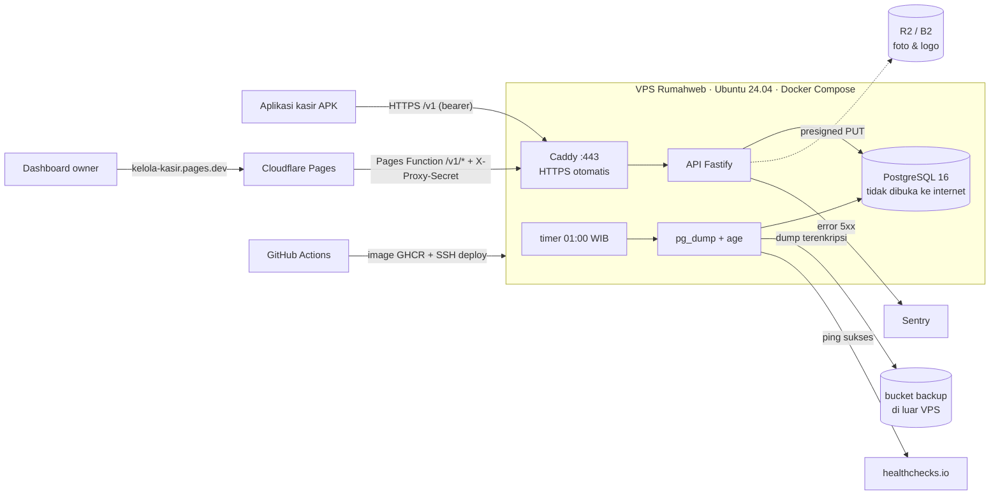

# Deploy: VPS (Rumahweb) + Cloudflare (DEAR-19)

Status: berlaku untuk MVP. Dasar keputusan: [ADR-0012](../adr/0012-vps-hosting.md) (menggantikan bagian hosting [ADR-0011](../adr/0011-free-tier-hosting.md)). Operasional harian (deploy ulang, rollback, restore, perawatan server): [runbook.md](runbook.md). APK kasir: [apk-release.md](apk-release.md).

Semua akun dibuat **atas nama owner**. Secret hanya diisi di `/opt/kelola-kasir/.env` di VPS, di dashboard Cloudflare, atau di GitHub Actions secrets. Secret tidak boleh masuk repo, komentar issue, atau chat. Tech Lead tidak butuh dan tidak akan meminta password atau private key server.

## Gambaran



| Komponen | Di repo | Tempat jalan |
|---|---|---|
| API | `apps/api/Dockerfile` → image `ghcr.io/simanjuntakalbert57/kelola-kasir-api:<sha>` | VPS, service `api` di `ops/vps/compose.yaml` |
| Database | service `db` (`postgres:16-alpine`, volume `pgdata`), role `backup_ro` dari `ops/vps/initdb/` | VPS |
| HTTPS | `ops/vps/Caddyfile` | VPS, service `caddy` |
| Migrasi DB | `node dist/db/migrate.js` di awal start container API (idempoten) | VPS |
| Deploy + rollback | `.github/workflows/deploy-vps.yml` | GitHub Actions → SSH user `deploy` |
| Dashboard + proxy | `apps/dashboard` + `apps/dashboard/functions/v1/[[path]].ts` | Cloudflare Pages |
| Backup harian | `ops/vps/backup-now.sh` + `ops/backup/` (timer dipasang `ops/vps/setup.sh`) | VPS → R2/B2 |
| Uptime | `.github/workflows/uptime.yml` (tiap 30 menit) | GitHub Actions |
| Error | `apps/api/src/lib/error-reporter.ts` (aktif bila `SENTRY_DSN` diisi) | Sentry Developer (free) |
| APK | `.github/workflows/android-apk.yml` | GitHub Actions |

Satu lingkungan: VPS ini dipakai sebagai **staging selama UAT** (DEAR-18). Sebelum go-live data direset ([runbook § Reset data sebelum go-live](runbook.md#reset-data-sebelum-go-live)), lalu VPS yang sama menjadi produksi. URL tidak berubah.

## Checklist owner (sekali)

Kerjakan berurutan. Setelah selesai, laporkan di komentar DEAR-19 **tanpa** menempelkan nilai secret.

### 1. VPS dan domain
- [ ] VPS **Rumahweb** dengan syarat: virtualisasi **KVM** (bukan OpenVZ/LXC, karena Docker butuh KVM), minimal **2 GB RAM** (disarankan 4 GB), 1 vCPU, 20 GB SSD. OS: **Ubuntu 24.04** (terpasang di VPS owner); AlmaLinux/Rocky 8–9 juga didukung. Tanpa control panel (cPanel/Plesk tidak dipakai). OS lain ditolak oleh `setup.sh`.
- [ ] Catat **IP publik VPS** dan password root dari email aktivasi atau client area Rumahweb. Password root hanya untuk login pertama, jangan ditempel di issue.
- [ ] Pasang **SSH key milik Bapak** untuk root. Kalau panel Rumahweb tidak menyediakan menu SSH key, jalankan dari laptop: `ssh-copy-id root@<ip-vps>` (sekali minta password root). Pastikan `ssh root@<ip-vps>` bisa masuk tanpa password, karena `setup.sh` mematikan login password setelah key terpasang.
- [ ] Domain API (wajib, untuk HTTPS): beli domain di Rumahweb atau registrar lain, lalu di pengaturan DNS buat **A record** `api` → IP VPS. Hasilnya `API_DOMAIN=api.<domain>`. Cek dengan `nslookup api.<domain>`, hasilnya harus IP VPS.
  - URL ini ditanam di APK. Kalau nanti diganti, APK harus dibangun dan dipasang ulang, jadi tetapkan sebelum APK rilis.

### 2. Cloudflare R2 (foto + backup)
- [ ] Daftar Cloudflare. Buka R2. **Bila diminta metode pembayaran, berhenti, jangan tambahkan kartu**, lalu pakai Backblaze B2 (langkah 2b).
- [ ] Buat bucket `kelola-kasir-media` (foto/logo). Settings → Public access → aktifkan **r2.dev subdomain**, lalu catat URL publiknya.
- [ ] Bucket `kelola-kasir-media` → Settings → CORS policy:
  ```json
  [{ "AllowedOrigins": ["https://kelola-kasir.pages.dev"], "AllowedMethods": ["PUT", "GET"], "AllowedHeaders": ["content-type"], "MaxAgeSeconds": 3600 }]
  ```
- [ ] Buat bucket `kelola-kasir-backup` (tanpa akses publik).
- [ ] R2 → Manage API tokens: token **Object Read & Write** khusus `kelola-kasir-media` (untuk API), dan token kedua khusus `kelola-kasir-backup` (untuk backup). Catat Access Key ID, Secret Access Key, dan endpoint `https://<account-id>.r2.cloudflarestorage.com`.

**2b. Alternatif Backblaze B2** (hanya bila R2 meminta kartu): buat dua bucket (media = Public, backup = Private), CORS media sama seperti di atas, dan satu Application Key per bucket. Endpoint `https://s3.<region>.backblazeb2.com`, URL publik `https://f00X.backblazeb2.com/file/kelola-kasir-media`.

### 3. Secret dan kunci (dibuat di laptop Bapak)
Simpan semua hasilnya di password manager.
- [ ] `pnpm --filter @kelola-kasir/api keys:generate` → `JWT_PRIVATE_KEY`.
- [ ] `openssl rand -hex 32`, **lima kali** → `PIN_FINGERPRINT_SECRET`, `PROXY_SHARED_SECRET`, `POSTGRES_PASSWORD`, `BACKUP_DB_PASSWORD`, dan satu cadangan. `PIN_FINGERPRINT_SECRET` tidak boleh berubah setelah ada pegawai, karena PIN lama tidak bisa dicocokkan lagi.
- [ ] Kunci backup: `age-keygen -o kelola-kasir-backup.key`. Simpan file ini di password manager (owner + Tech Lead). Hanya **public key** `age1...` yang ditaruh di VPS.
- [ ] Deploy key GitHub → VPS: `ssh-keygen -t ed25519 -N '' -C github-deploy -f kelola-kasir-deploy`. Hasilnya dua file: `kelola-kasir-deploy` (private, untuk GitHub secret) dan `kelola-kasir-deploy.pub` (public, untuk `setup.sh`).
- [ ] Sentry: daftar sentry.io plan Developer (gratis), buat project **Node.js** `kelola-kasir-api`, lalu salin **DSN**.
- [ ] healthchecks.io (gratis): buat check `kelola-kasir-backup`, period **1 day**, grace **2 hours**, notifikasi email owner. Salin **ping URL**-nya.

### 4. Siapkan server (sekali, ±10 menit)
SSH ke VPS sebagai root (`ssh root@<ip-vps>`), lalu:
```sh
curl -fsSLO https://raw.githubusercontent.com/simanjuntakalbert57/kelola-kasir/main/ops/vps/setup.sh
less setup.sh                      # baca dulu isinya
bash setup.sh '<isi file kelola-kasir-deploy.pub: satu baris ssh-ed25519 AAAA... github-deploy>'
```
Script ini memasang Docker (di AlmaLinux: Docker CE dari repo resmi Docker; di Ubuntu yang sudah membawa Docker CE, seperti image Hostinger, Docker CE itu dipakai dan hanya plugin Compose yang ditambahkan), firewall (22/80/443; `firewalld` di AlmaLinux, `ufw` di Ubuntu), fail2ban, update keamanan otomatis, swap, user `deploy`, folder `/opt/kelola-kasir`, dan timer backup 01:00 WIB. Di akhir, script mencetak satu baris **host key** (`<ip> ssh-ed25519 AAAA...`). Salin baris itu untuk langkah 6.
- [ ] Bila muncul peringatan "SSH password login stays ON", pasang SSH key dulu (`ssh-copy-id root@<ip-vps>`), lalu jalankan script lagi.

### 5. Isi `/opt/kelola-kasir/.env` di VPS
Folder ini baru berisi file setelah deploy pertama (langkah 6). Kalau mau mengisi `.env` lebih dulu, buat dari template yang sama:
```sh
cd /opt/kelola-kasir
curl -fsSL -o env.example https://raw.githubusercontent.com/simanjuntakalbert57/kelola-kasir/main/ops/vps/env.example
cp env.example .env && chmod 600 .env && chown deploy:deploy .env
nano .env
```

| Variable | Nilai |
|---|---|
| `API_DOMAIN` | dari langkah 1, tanpa `https://` |
| `ACME_EMAIL` | email owner (pemberitahuan sertifikat) |
| `POSTGRES_PASSWORD`, `BACKUP_DB_PASSWORD` | dari langkah 3 (hex) |
| `JWT_PRIVATE_KEY`, `PIN_FINGERPRINT_SECRET`, `PROXY_SHARED_SECRET` | dari langkah 3 |
| `STORAGE_ENDPOINT`, `STORAGE_ACCESS_KEY_ID`, `STORAGE_SECRET_ACCESS_KEY` | endpoint dan token **media** |
| `STORAGE_PUBLIC_BASE_URL` | URL publik r2.dev / B2 bucket media |
| `SENTRY_DSN` | DSN Sentry; `SENTRY_ENVIRONMENT=staging` selama UAT |
| `AGE_RECIPIENT` | public key `age1...`. **Selama UAT boleh kosong**: backup belum aktif (keputusan owner 26 Okt 2026) dan timer hanya mencatat "backup skipped". Wajib diisi sebelum go-live. |
| `BACKUP_S3_ENDPOINT`, `BACKUP_S3_ACCESS_KEY_ID`, `BACKUP_S3_SECRET_ACCESS_KEY` | endpoint dan token **backup** |
| `BACKUP_HEARTBEAT_URL` | ping URL healthchecks.io |

### 6. GitHub (repo → Settings → Secrets and variables → Actions) dan deploy pertama
- [ ] **Secret** `VPS_SSH_KEY`: isi file **private** `kelola-kasir-deploy` (seluruhnya, termasuk baris BEGIN/END). Setelah itu hapus file private dari laptop, atau simpan di password manager.
- [ ] **Variables**:

  | Variable | Nilai |
  |---|---|
  | `VPS_HOST` | IP VPS |
  | `VPS_KNOWN_HOSTS` | baris host key dari akhir `setup.sh` |
  | `API_HEALTH_URL` | `https://<API_DOMAIN>/healthz` |
  | `DASHBOARD_URL` | `https://kelola-kasir.pages.dev` |
  | `KASIR_API_URL` | `https://<API_DOMAIN>/v1` |

- [ ] Actions → **Deploy API to VPS** → Run workflow (tag kosong). Workflow membangun image, menyalin `ops/vps` ke `/opt/kelola-kasir`, lalu menjalankan `db`, `api`, dan `caddy`.
- [ ] Buka `https://<API_DOMAIN>/healthz` → `{"status":"ok","db":"up"}`. Sertifikat HTTPS dibuat otomatis saat pertama diakses (butuh DNS A record sudah aktif).

Sesudah ini, setiap merge ke `main` yang lolos CI akan otomatis di-deploy.

### 7. Cloudflare Pages (dashboard)
- [ ] Workers & Pages → Create → **Pages** → Connect to Git → repo `kelola-kasir`. Nama project: `kelola-kasir`, production branch `main`.
- [ ] Build settings:

  | Field | Nilai |
  |---|---|
  | Framework preset | None |
  | Root directory | `apps/dashboard` |
  | Build command | `pnpm install --frozen-lockfile --filter @kelola-kasir/dashboard... && pnpm --filter @kelola-kasir/dashboard build` |
  | Build output directory | `dist` |

- [ ] Environment variables (Production), **Build**: `NODE_VERSION=24.18.0`, `PNPM_VERSION=10.34.9`.
- [ ] Environment variables (Production), **Runtime/Functions**: `API_ORIGIN=https://<API_DOMAIN>` (tanpa `/v1`), dan `PROXY_SHARED_SECRET` (tipe **Secret**, nilainya sama dengan di `.env` VPS).
- [ ] Deploy, lalu buka `https://kelola-kasir.pages.dev`. Halaman login harus tampil, dan `https://kelola-kasir.pages.dev/v1/me` menjawab `401` (bukti proxy tersambung).

### 8. Akun owner pertama
Di VPS (database tidak bisa diakses dari luar, jadi perintah dijalankan di dalam container API):
```sh
cd /opt/kelola-kasir
read -rs -p 'Password owner (min 12 karakter): ' OWNER_PASSWORD; echo
./compose.sh exec -e OWNER_EMAIL='<email owner>' -e OWNER_PASSWORD="$OWNER_PASSWORD" \
  -e OUTLET_CODE=JUS1 -e OUTLET_NAME='<nama toko>' api node dist/scripts/create-owner.js
unset OWNER_PASSWORD
```
Lalu login di dashboard dan isi Pengaturan toko (header/footer struk, QRIS statis).

### 9. Backup pertama + uji restore
> **Ditunda selama UAT** (keputusan owner 26 Okt 2026). Langkah 2 bucket `kelola-kasir-backup`, kunci age, healthchecks.io, dan langkah ini **wajib selesai sebelum go-live** dengan data asli.

- [ ] Di VPS: `sudo -u deploy /opt/kelola-kasir/backup-now.sh`. Objek `postgres/kelola-kasir-<timestamp>.dump.age` harus muncul di bucket backup, dan healthchecks.io berstatus **up**.
- [ ] `systemctl list-timers kelola-kasir-backup.timer` menampilkan jadwal berikutnya (01:00 WIB).
- [ ] Uji restore di laptop (backup-restore.md § Restore), lalu catat hasilnya di issue.

### 10. Konfirmasi
- [ ] Komentar di DEAR-19: langkah mana yang sudah selesai, `API_DOMAIN`, URL dashboard, dan R2 atau B2 yang dipakai. **Tanpa nilai secret.**

## Environment variable API

Diset oleh `ops/vps/compose.yaml` dari `.env`:

| Variable | Wajib | Keterangan |
|---|---|---|
| `NODE_ENV`, `PORT`, `TRUST_PROXY=1`, `DB_POOL_MAX=10` | tetap | di `compose.yaml` |
| `DATABASE_URL`, `DATABASE_URL_DIRECT` | tetap | dibentuk dari `POSTGRES_PASSWORD`; keduanya `db:5432` |
| `JWT_PRIVATE_KEY`, `PIN_FINGERPRINT_SECRET` | ya | secret aplikasi |
| `PROXY_SHARED_SECRET` | ya | sama dengan di Pages; API memercayai `X-Client-IP` hanya dari proxy (rate limit login per IP asli) |
| `STORAGE_*` | untuk upload foto | tanpa ini `POST /v1/uploads` menjawab 503 |
| `SENTRY_DSN`, `SENTRY_ENVIRONMENT` | tidak | error 5xx dikirim ke Sentry (tanpa header, cookie, body) |
| `CORS_ORIGINS` | tidak | tidak diset; dashboard memakai proxy same-origin |

Health check: Docker memanggil `/healthz` di dalam container (deploy menunggu status sehat). Uptime check GitHub memanggil `https://<API_DOMAIN>/healthz` dari luar.
