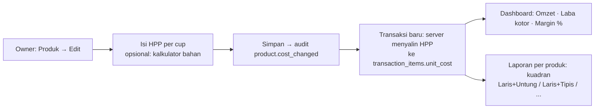

# Konsep A — HPP & Laba Kotor per Menu

Status: usulan (menunggu keputusan Albert) · Ide #1 di [backlog](../backlog.md) · Penyusun: Product Manager (Ide & Benchmark) · Tanggal: 2026-10-26 · Issue: DEAR-24
Rujukan `§` di dokumen ini mengacu ke [discovery-fase2.md](../discovery-fase2.md).

## Latar belakang
Dashboard MVP menjawab "berapa omzet hari ini", tetapi belum menjawab "berapa untungnya". Di gerai jus, harga buah naik-turun mingguan dan porsi tiap menu berbeda, sehingga menu terlaris belum tentu yang paling menguntungkan. Majoo menaruh HPP di paket Advance (Rp499.000/bulan) dan Toast menjual *recipe costing* dengan laporan margin per produk (lihat §3). Kita mengambil inti polanya saja: **owner mengisi perkiraan HPP per menu, sistem menghitung laba kotor**, tanpa harus langsung membangun stok bahan baku lengkap (O-12).

## Persona
- **Albert, owner** — ingin tahu menu mana yang layak didorong, mana yang perlu naik harga, dan berapa laba kotor per hari/minggu. Tidak sempat menghitung manual di spreadsheet.

## User stories
1. Sebagai owner, saya ingin mengisi HPP (biaya bahan per cup) di form produk, supaya sistem tahu margin tiap menu.
2. Sebagai owner, saya ingin melihat laba kotor hari ini dan margin rata-rata di dashboard, di samping omzet.
3. Sebagai owner, saya ingin laporan per produk menampilkan qty, omzet, HPP, laba kotor, dan margin %, lalu bisa diurutkan, supaya saya tahu menu mana yang menguntungkan.
4. Sebagai owner, saat harga buah naik saya ingin memperbarui HPP tanpa mengubah laporan masa lalu (snapshot, seperti harga jual).
5. Sebagai owner, saya ingin ditandai menu yang margin-nya di bawah ambang (mis. < 40%), supaya saya bisa menyesuaikan harga atau porsi.

## Alur

## Dampak arsitektur
- **API/DB**: kolom `products.cost` (BIGINT, nullable) dan `transaction_items.unit_cost` (snapshot). HPP diisi server saat transaksi diterima (online atau `sync/push`), jadi **aplikasi kasir dan outbox tidak berubah** dan pegawai tidak pernah melihat HPP.
- **Kontrak**: `Product` mendapat `cost` (hanya di endpoint owner, tidak di `sync/pull`); `DashboardSummary` mendapat `gross_profit` dan `cost_coverage` (porsi omzet yang HPP-nya terisi); `reports/sales?group_by=product` mendapat kolom HPP/laba.
- **Biaya**: gratis. Query agregat tetap kecil (≤ 500 trx/hari, TDD §3.4).

## Kriteria penerimaan
- HPP opsional; produk tanpa HPP tetap bisa dijual dan ditandai "HPP belum diisi" di laporan. Laba kotor hanya dihitung dari item yang punya HPP, dan dashboard menampilkan cakupannya (mis. "HPP terisi untuk 85% omzet").
- Mengubah HPP **tidak** mengubah laba transaksi lama. Perubahan dicatat di audit log.
- Transaksi void/cancelled tidak masuk laba kotor (aturan sama dengan omzet).
- HPP tidak pernah dikirim ke perangkat kasir (`sync/pull`, struk, riwayat).
- Laporan per produk bisa diekspor CSV/XLSX dengan kolom HPP dan laba.

## Metrik sukses
- ≥ 80% produk aktif punya HPP dalam 2 minggu setelah rilis.
- Albert membuka laporan margin minimal 1×/minggu (event `report.margin_viewed`).
- Dalam 2 bulan ada minimal 1 keputusan harga/porsi yang diambil berdasarkan laporan ini (dicek lewat wawancara singkat dengan Albert).

## MVP-fitur vs nanti
| MVP-fitur (±2 hari) | Nanti |
|---|---|
| Input HPP manual per produk, snapshot di transaksi, laba kotor + margin di dashboard, laporan per produk dengan margin & ekspor | Kalkulator HPP dari daftar bahan (harga buah per kg × gram per cup) → jembatan ke stok bahan (ide #7) |
| Tanda margin di bawah ambang | Matriks *menu engineering* (laris × untung) dan saran harga |
| | Pengingat "harga buah naik? perbarui HPP" bila HPP tidak diubah > 30 hari |

## Pertanyaan terbuka
- Apakah cup, sedotan, dan plastik dimasukkan ke HPP per menu, atau dicatat sebagai biaya terpisah?
- Ambang margin default berapa? Usulan awal 40% (asumsi, perlu konfirmasi Albert).
