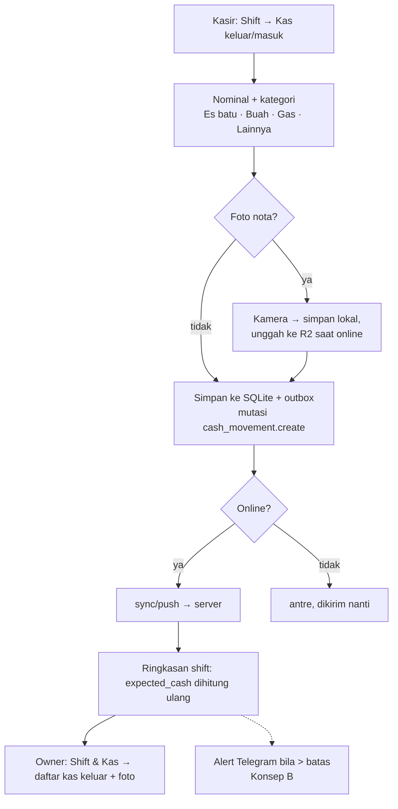

# Konsep C — Kas Keluar/Masuk di Shift (pengeluaran dari laci)

Status: usulan (menunggu keputusan Albert) · Ide #3 di [backlog](../backlog.md) · Penyusun: Product Manager (Ide & Benchmark) · Tanggal: 2026-10-26 · Issue: DEAR-24
Rujukan `§` di dokumen ini mengacu ke [discovery-fase2.md](../discovery-fase2.md).

## Latar belakang
Di gerai jus, uang di laci sering dipakai untuk belanja kecil di tengah hari: es batu, buah tambahan, gas, galon, atau parkir. Di MVP, uang yang keluar itu langsung menjadi **selisih kas minus** saat tutup shift (`expected_cash = modal + penjualan cash`, `apps/api/src/modules/shifts/summary.ts`). Owner jadi tidak bisa membedakan pengeluaran sah dari kebocoran, dan metrik "selisih kas terlihat" kehilangan makna. Loyverse (gratis) mencatat *Pay In / Pay Out* di shift dan memasukkannya ke perhitungan kas seharusnya; Majoo punya laporan closing dan rekonsiliasi kasir di semua paket (lihat §3).

## Persona
- **Pegawai kasir** — disuruh beli es batu dengan uang laci. Ingin mencatatnya cepat (≤ 15 detik) supaya tidak dianggap kurang setor.
- **Albert, owner** — ingin tahu ke mana uang tunai keluar, dengan bukti, dan ingin selisih kas hanya menunjukkan hal yang benar-benar janggal.

## User stories
1. Sebagai kasir, saya ingin mencatat **kas keluar** (nominal, kategori, catatan, foto nota opsional) dari menu Shift, termasuk saat offline.
2. Sebagai kasir, saya ingin mencatat **kas masuk** non-penjualan (mis. owner menambah uang kembalian).
3. Sebagai kasir, saya ingin ringkasan tutup shift menghitung kas seharusnya = modal + penjualan cash − kas keluar + kas masuk, supaya selisih saya benar.
4. Sebagai owner, saya ingin melihat daftar kas keluar per shift dan per kategori, lengkap dengan foto nota, dan total pengeluaran operasional per bulan.
5. Sebagai owner, saya ingin kas keluar di atas batas tertentu (mis. Rp100.000) butuh PIN owner atau langsung memicu alert.

## Alur

## Dampak arsitektur
- **Offline-first tetap terjaga**: mutasi baru `cash_movement.create` di outbox, ID UUIDv7 dari klien, idempoten seperti transaksi (ADR-0008). Pola penerimaan sama dengan transaksi telat: diterima dan ditandai bila tiba setelah shift ditutup.
- **DB**: tabel `cash_movements` (id, outlet_id, shift_id, device_id, employee_id, direction `out|in`, amount BIGINT, category, note, receipt_image_url, client_created_at, server_received_at). `ShiftSummary` menambah `total_cash_out`, `total_cash_in`; rumus `expected_cash` berubah. Ini **perubahan perilaku pada alur uang**, jadi test plan §5 (shift/selisih) perlu kasus baru P0.
- **Kontrak**: mutasi baru di `sync/push`, `GET /shifts/{id}/cash-movements`, `GET /reports/expenses`. `POST /uploads` mendapat `purpose=expense_receipt`.
- **Kasir**: 1 layar baru (sheet) dari menu Shift; alur Cash 3 tap tidak tersentuh.
- **Biaya**: gratis. Foto nota dikompres (≤ 200 KB) di R2; ±10 foto/hari ≈ 60 MB/bulan, jauh di bawah kuota gratis R2 10 GB (ADR-0011).

## Kriteria penerimaan
- Kas keluar/masuk bisa dicatat offline dan tersinkron tanpa duplikat (kirim ulang aman).
- `expected_cash = opening_cash + total_cash_sales − total_cash_out + total_cash_in`, dan dihitung ulang bila mutasi tiba setelah shift ditutup. Perubahan dicatat di audit (`shift.totals_recomputed`).
- Kas keluar tidak bisa melebihi estimasi uang di laci saat itu (validasi lokal dengan peringatan, bukan blokir keras, karena data bisa belum lengkap saat offline).
- Kas keluar tidak bisa diedit, hanya dibatalkan dengan alasan, dan pembatalan diaudit (konsisten dengan prinsip transaksi append-only).
- Owner melihat daftar per shift dan rekap per kategori per periode, serta bisa mengekspornya.
- Pegawai tetap tidak melihat omzet keseluruhan.

## Metrik sukses
- ≥ 90% shift yang punya pengeluaran mencatatnya lewat fitur ini (dicek dengan bertanya ke Albert di minggu ke-2 dan ke-4).
- Porsi shift dengan |selisih| ≥ ambang turun dibanding 4 minggu pertama setelah MVP (baseline diambil dari data MVP).
- Albert bisa menjawab "berapa pengeluaran operasional tunai bulan ini" dari satu layar.

## MVP-fitur vs nanti
| MVP-fitur (±3 hari) | Nanti |
|---|---|
| Kas keluar/masuk + kategori tetap + catatan, offline, masuk ke ringkasan shift & dashboard owner | Foto nota (bisa ikut MVP-fitur bila effort masih muat) |
| Rekap kas keluar per kategori di dashboard | Batas nominal yang butuh PIN owner |
| | Kategori "Belanja buah" langsung menambah stok bahan (ide #7) |
| | Laba bersih sederhana = laba kotor (Konsep A) − pengeluaran |

## Pertanyaan terbuka
- Apakah belanja buah besar dibayar dari laci gerai atau dari kantong owner? Ini menentukan apakah kategori "Belanja buah" perlu masuk MVP-fitur.
- Perlukah PIN owner untuk nominal besar sejak awal, atau cukup alert?
