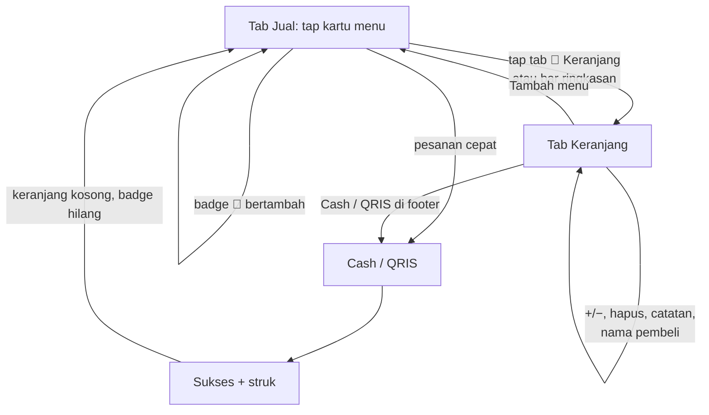

# Konsep — Tab "Keranjang" ala Marketplace (cek pesanan + bayar)

Status: usulan, **kandidat MVP** (menunggu keputusan Albert) · Ide K-3 di [backlog](../backlog.md) · Penyusun: Product Manager (Ide & Benchmark) · Tanggal: 2026-10-27 · Sumber: permintaan Albert lewat chat

## Ringkasan eksekutif
- Albert ingin **menu Keranjang tersendiri** seperti di marketplace. Di menu itu pegawai bisa mengecek isi pesanan dan langsung membayar (Cash/QRIS).
- Fungsi keranjang sebenarnya sudah ada (`apps/kasir/app/cart.tsx`), tetapi tersembunyi: satu-satunya jalan masuk adalah teks kecil di bar bawah layar Jual, dan di layar itu tidak bisa membayar (tombolnya "Lanjut ke jual").
- Usulan: tambah tab **🛒 Keranjang** dengan badge jumlah item di navigasi bawah. Layar Keranjang punya ringkasan dan tombol **Cash/QRIS** di bagian bawah.
- **Tanpa detail produk** (keputusan Albert, 2026-10-27). Tidak ada lembar detail, foto besar, atau deskripsi.
- Hanya mengubah aplikasi kasir. API dan DB tidak berubah, biaya tetap gratis, alur Cash 3 tap dari layar Jual tetap utuh. Effort ±1,5–2 hari (estimasi).

## Latar belakang
Pada 2026-10-27 Albert mengirim tangkapan layar Jual berisi 12 item (Rp150.000) dan menyimpulkan "ngak ada keranjang". Artinya fitur yang ada tidak ditemukan. Penyebabnya:
1. Tidak ada ikon, judul, atau tab "Keranjang". Pintu masuknya hanya teks ringkasan "12 item · Rp150.000" dengan petunjuk "Ketuk untuk ubah pesanan".
2. Layar keranjang saat ini bernama "Pesanan" dan berakhir di tombol "Lanjut ke jual", jadi pegawai harus kembali ke Jual untuk membayar.

Pegawai butuh tempat yang jelas untuk **mengecek ulang pesanan besar sebelum bayar** supaya tidak salah jumlah. Salah jumlah berujung void atau selisih kas.

## Benchmarking
| Produk | Fitur/Pola | Apa yang bisa kita adopsi |
|---|---|---|
| Tokopedia / Shopee (marketplace) | Ikon keranjang dengan badge angka selalu terlihat. Halaman keranjang berisi daftar item, stepper +/−, catatan, dan *sticky footer* "Total + Checkout" | Tab dengan badge plus footer total dan tombol bayar yang selalu terlihat. **Tidak** kita adopsi: halaman checkout terpisah dan centang per item, karena di gerai tidak ada "beli sebagian". |
| GoFood / GrabFood (pemesanan F&B) | Bar "Lihat keranjang · N item · Rp…" di bawah menu, dengan catatan per item | Sudah mirip bar bawah Jual kita. Yang kurang: label yang jelas dan ikon. |
| Loyverse / Moka POS (kompetitor POS) | Di HP, tiket/keranjang adalah panel atau layar sendiri dengan tombol "Charge/Bayar" langsung di bawahnya | Tombol bayar ditempel di layar keranjang, bukan hanya di layar katalog. |

Catatan: pola di atas berasal dari pengamatan umum aplikasi-aplikasi tersebut dan belum diverifikasi ulang dengan riset web untuk dokumen ini.

## Persona
- **Pegawai kasir** memegang HP Android portrait dengan satu tangan saat antrean ramai. Pegawai ingin melihat semua isi pesanan sekaligus dan membayar tanpa bolak-balik layar.
- **Albert, owner** ingin pegawai jarang salah input, supaya void dan selisih kas berkurang.

## User stories
1. Sebagai kasir, saya ingin melihat tab **Keranjang** dengan angka jumlah item, supaya saya tahu ada pesanan yang belum dibayar.
2. Sebagai kasir, saya ingin di tab Keranjang melihat semua item beserta jumlah, harga satuan, subtotal, dan total, lalu mengubah jumlah (+/−), menghapus item, dan menambah catatan atau nama pembeli.
3. Sebagai kasir, saya ingin langsung menekan **Cash** atau **QRIS** dari tab Keranjang, tanpa kembali ke layar Jual.
4. Sebagai kasir, saya ingin tetap bisa membayar langsung dari layar Jual untuk pesanan cepat (alur 3 tap).
5. Sebagai kasir, saya ingin bisa mengosongkan keranjang dengan konfirmasi, supaya pesanan yang batal tidak terbawa ke pembeli berikutnya.

## Alur pengguna


Sketsa layar (portrait):
```
┌───────────────────────────────┐
│ Keranjang (12)      Kosongkan │
│ Nama pembeli: [Budi        ]  │
│ Alpukat          − 6 +        │
│ Rp13.000      Rp78.000  Hapus │
│ Catatan: less sugar           │
│ Jus Mangga       − 6 +        │
│ Rp12.000      Rp72.000  Hapus │
│ + tambah catatan              │
├───────────────────────────────┤
│ 12 item · TOTAL Rp150.000     │
│ [   Cash   ]  [   QRIS   ]    │
├───────────────────────────────┤
│ 🍹Jual │🛒Keranjang 12│🧾Riwayat│⏱Shift │
└───────────────────────────────┘
```

## Dampak arsitektur & biaya
- **Kasir saja.** State keranjang sudah dipegang `SalesProvider` (`useSales().cart`), jadi layar Jual dan tab Keranjang membaca sumber yang sama. Isi layar `cart.tsx` bisa dipindah ke `app/(tabs)/keranjang.tsx`.
- **Navigasi:** tab bar menjadi 4 item (Jual, Keranjang, Riwayat, Shift). Lebar tetap muat di layar portrait 360 dp.
- **Pembayaran:** tombol Cash/QRIS di Keranjang membuka layar yang sama (`/cash`, `/qris`) dengan aturan aktif/nonaktif yang sama dengan layar Jual (total > 0, QRIS harus aktif).
- **API/DB/OpenAPI:** tidak berubah. Offline-first tidak tersentuh, karena keranjang tetap lokal sampai transaksi dibuat.
- **Biaya:** gratis.
- **Keputusan terkunci:** tidak ada yang berubah. Alur Cash 3 tap dari Jual tetap (tap menu → Cash → Uang Pas). Lewat Keranjang jadi 4 tap, tapi itu jalur opsional untuk pesanan yang ingin dicek.
- **Dokumen yang perlu diperbarui oleh engineering/desain** (bukan di PR ini): `docs/design/kasir.html` (K-04), `docs/qa/test-plan.md`.

## Kriteria penerimaan
- Tab **Keranjang** muncul di navigasi bawah, di antara Jual dan Riwayat. Badge menampilkan jumlah item (bukan jumlah baris) dan disembunyikan saat keranjang kosong.
- Isi tab Keranjang: daftar item (nama, harga satuan, stepper +/−, subtotal baris, hapus, catatan), kolom nama pembeli, dan footer berisi jumlah item, total, tombol **Cash**, dan tombol **QRIS**.
- Footer selalu terlihat, juga saat daftar di-scroll.
- Aturan tombol Cash/QRIS di Keranjang sama persis dengan di Jual.
- Setelah transaksi sukses, keranjang kosong dan badge hilang.
- Keranjang kosong menampilkan pesan "Keranjang kosong" dan tombol "Pilih menu" yang membuka tab Jual.
- "Kosongkan" meminta konfirmasi dulu.
- Bar ringkasan di layar Jual diberi ikon 🛒. Mengetuknya membuka tab Keranjang. Tombol Cash/QRIS di Jual tetap ada.
- Alur Cash 3 tap dari layar Jual lulus uji seperti sebelumnya.
- **Tidak ada** layar atau lembar detail produk.

## Metrik sukses
Metrik ini belum bisa diukur otomatis karena belum ada event analitik di aplikasi kasir. Sumbernya data yang sudah ada ditambah pengamatan.
- **Void karena salah input** turun dibanding 2 minggu sebelum rilis (dari alasan void di dashboard).
- Albert atau pegawai bisa menemukan keranjang tanpa diberi tahu (tanya pegawai di minggu pertama).
- Waktu rata-rata transaksi cepat tidak naik (dicek manual: alur 3 tap tetap ≤ 10 detik).

## Ruang lingkup: MVP-fitur vs nanti
| MVP-fitur (±1,5–2 hari, estimasi) | Nanti / tidak dikerjakan |
|---|---|
| Tab Keranjang dan badge | Detail produk (**ditolak Albert**, 2026-10-27) |
| Footer total + Cash/QRIS | Simpan beberapa keranjang (*open bill*/parkir pesanan) — ide terpisah bila dibutuhkan |
| Konfirmasi "Kosongkan" + ikon 🛒 di bar Jual | Panel keranjang mini di bawah menu Jual (usulan sebelumnya; lihat pertanyaan terbuka) |

## RICE
| R | I | C | E (hari) | Skor |
|---|---|---|---|---|
| 10 (semua transaksi, semua pegawai) | 1 | 80% | 2 | **4,0** |

Semua nilai adalah estimasi PM dengan skala yang sama seperti [discovery-fase2.md §4](../discovery-fase2.md#4-backlog-ide-fase-2-rice).

## Pertanyaan terbuka (untuk Albert)
1. Apakah tab Keranjang **menggantikan** usulan sebelumnya (panel keranjang langsung di bawah menu Jual), atau dua-duanya dipakai? Rekomendasi PM: cukup tab Keranjang dulu, karena lebih sederhana. Panel mini bisa ditambah kalau pegawai masih kurang terbantu.
2. Masuk ke MVP sekarang, atau langsung setelah rilis?
