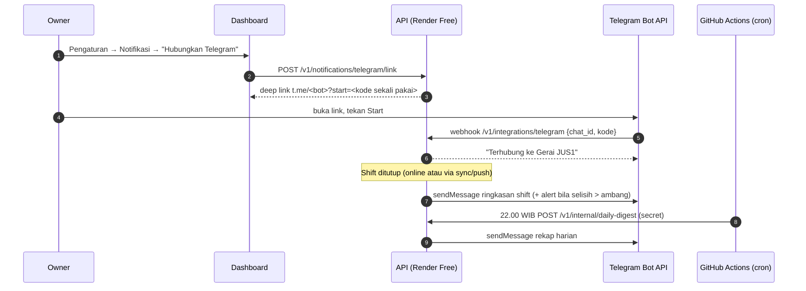

# Konsep B — Laporan & Alert Otomatis ke HP Owner (Telegram dulu, WhatsApp nanti)

Status: usulan (menunggu keputusan Albert) · Ide #2 di [backlog](../backlog.md) · Penyusun: Product Manager (Ide & Benchmark) · Tanggal: 2026-10-26 · Issue: DEAR-24
Rujukan `§` di dokumen ini mengacu ke [discovery-fase2.md](../discovery-fase2.md).

## Latar belakang
Dashboard MVP bersifat *pull*: Albert harus membuka web untuk tahu kondisi gerai. Majoo menjual add-on laporan dan closing kasir ke WhatsApp seharga Rp499.000/outlet/bulan, dan pertanyaan nomor satu ke asisten AI Toast adalah *daily briefing* (lihat §3). Artinya owner memang mau laporan yang datang sendiri. Untuk owner usaha kecil di Indonesia, kanal yang paling cepat dibaca adalah chat (asumsi), dan Telegram Bot API gratis. Dengan pola ini Albert tidak perlu membuka dashboard setiap malam, dan **kejadian berisiko (selisih kas, void, QRIS manual) langsung terlihat**, bukan baru ketahuan saat rekap.

## Persona
- **Albert, owner** — ingin tenang tanpa terus membuka dashboard; perlu tahu segera kalau ada yang janggal.
- **Pegawai kasir** (tidak langsung) — tahu bahwa tutup shift langsung terkirim ke owner, sehingga disiplin hitung kas meningkat.

## User stories
1. Sebagai owner, saya ingin menghubungkan akun Telegram saya ke Kelola Kasir dari halaman Pengaturan dengan sekali klik, tanpa mengetik token.
2. Sebagai owner, saya ingin menerima ringkasan **setiap kali shift ditutup**: kasir, modal, penjualan cash/QRIS, kas aktual, selisih, jumlah transaksi, void, dan QRIS yang dikonfirmasi manual.
3. Sebagai owner, saya ingin menerima **rekap harian** pukul 22.00 WIB: omzet, transaksi, rata-rata per transaksi, 3 menu terlaris, dan perbandingan dengan hari yang sama minggu lalu.
4. Sebagai owner, saya ingin **alert segera** bila selisih kas melewati ambang (mis. ± Rp10.000), ada permintaan void, atau ada transaksi yang masuk setelah shift ditutup.
5. Sebagai owner, saya ingin mengatur jenis notifikasi dan ambangnya, dan mematikannya kapan saja.
6. Sebagai owner, saya ingin menyetujui atau menolak void langsung dari tombol di chat (nanti).

## Alur

## Dampak arsitektur
- **Event-driven, tanpa worker**: pesan shift dan alert dikirim saat request yang memicunya diproses (tutup shift, `sync/push`, ajukan void), jadi cocok dengan Render Free yang tidak punya cron (TDD §2.1). Kirim dilakukan setelah commit dengan retry singkat; kegagalan dicatat di tabel `notification_log` dan diulang saat request berikutnya.
- **Rekap harian** memakai GitHub Actions terjadwal, pola yang sama dengan backup harian (ADR-0011). Panggilan ini juga "membangunkan" API, dan 1 panggilan/hari tidak berarti bagi kuota Neon (R-10).
- **Tabel baru**: `notification_channels` (outlet, user, type=`telegram|whatsapp`, chat_id, prefs JSONB, verified_at) dan `notification_log`.
- **Kontrak OpenAPI**: endpoint link/unlink/preferensi kanal, webhook Telegram (diverifikasi `secret_token` header), endpoint internal digest. Aplikasi kasir **tidak berubah**.
- **Tutup shift offline**: pesan dikirim saat mutasi `shift.close` diterapkan server, dengan label "ditutup offline, angka bisa berubah". Transaksi telat (`after_shift_close`) memicu pesan susulan.
- **Biaya**: Telegram Bot API gratis. WhatsApp Cloud API berbayar per pesan template (lihat §3), jadi masuk tahap "nanti" dan perlu persetujuan biaya.

## Kriteria penerimaan
- Owner bisa menghubungkan dan memutus Telegram dari dashboard. Kode link sekali pakai dan kedaluwarsa 10 menit.
- Ringkasan shift terkirim ≤ 1 menit setelah server menerima tutup shift (online). Isinya cocok dengan `GET /shifts/{id}/summary`.
- Alert selisih kas hanya terkirim bila |selisih| ≥ ambang yang diatur owner. Default Rp10.000 (asumsi, bisa diubah).
- Rekap harian terkirim sekali per hari bisnis (WIB) meski cron terpicu dua kali (idempoten per `outlet_id + tanggal`).
- Gagal kirim tidak menggagalkan transaksi atau tutup shift. Kegagalan tercatat dan dicoba lagi.
- Pesan tidak memuat PIN, token, atau data pelanggan.

## Metrik sukses
- Albert mengaktifkan notifikasi dan tetap aktif ≥ 30 hari.
- Frekuensi buka dashboard untuk "cek omzet malam" turun, sedangkan waktu dari tutup shift sampai owner melihat selisih turun dari "keesokan hari" menjadi < 5 menit (metrik PRD: < 1 menit setelah tutup shift).
- Rata-rata |selisih kas| per shift turun dalam 4–6 minggu (efek disiplin, hipotesis yang perlu diuji).

## MVP-fitur vs nanti
| MVP-fitur (±3 hari) | Nanti |
|---|---|
| Link Telegram, ringkasan tutup shift, alert selisih kas & void, rekap harian 22.00, pengaturan on/off + ambang | Tombol Setujui/Tolak void di chat (callback Telegram) |
| | WhatsApp Cloud API (berbayar) sebagai kanal alternatif |
| | Rekap mingguan + insight otomatis (jembatan ke ide #11) |

## Pertanyaan terbuka
- Albert lebih nyaman menerima di Telegram atau harus WhatsApp? WhatsApp berarti biaya per pesan dan verifikasi bisnis Meta.
- Siapa lagi yang perlu menerima (mis. manajer/keluarga)? Model `outlet_members` sudah mendukung lebih dari satu akun.
