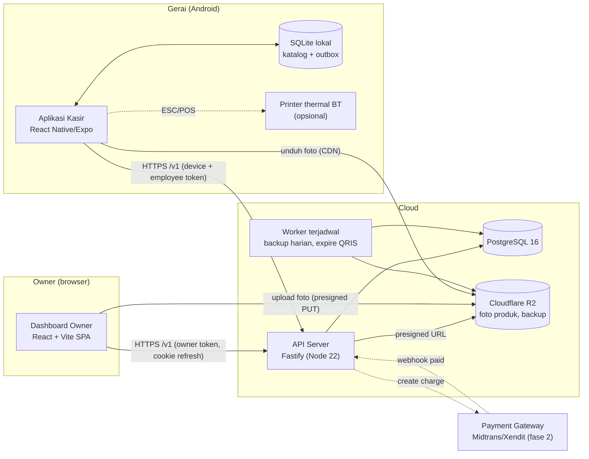
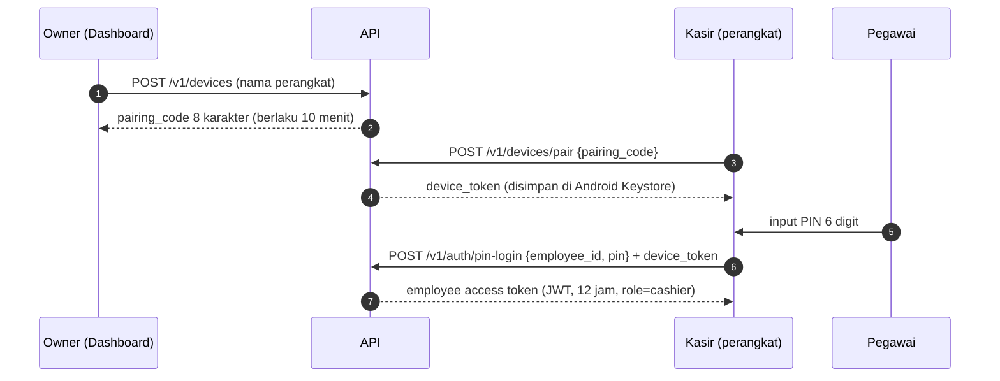
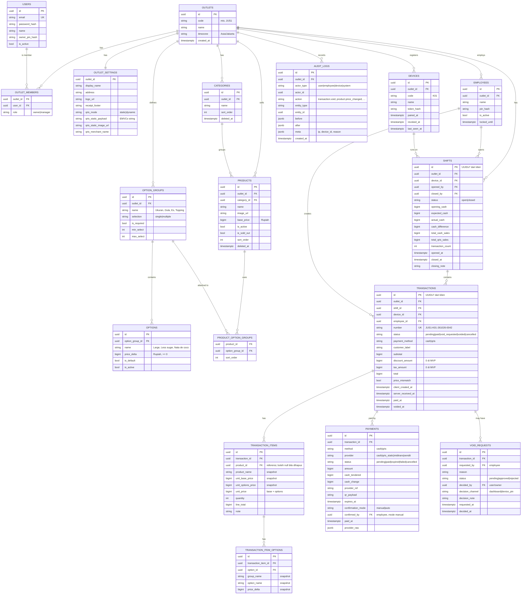
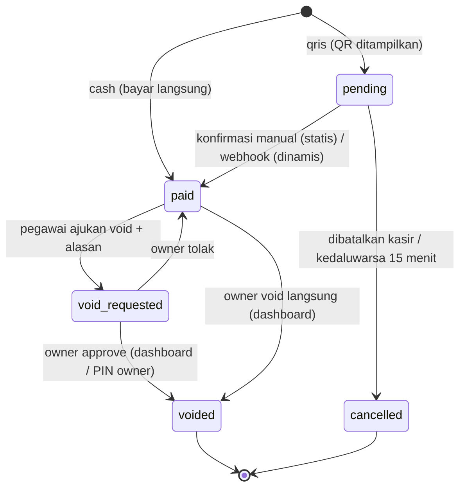
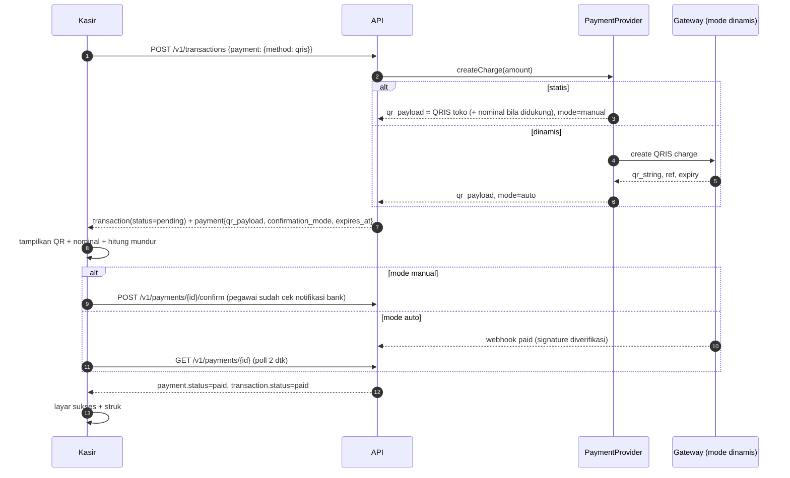
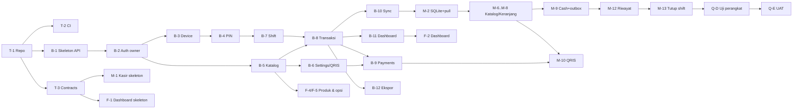

Technical Design Document — Kelola Kasir (Toko Jus) · MVP v1

Status: Draft v1 · Penyusun: Tech Lead · Tanggal: 2026-10-26 · Sumber: PRD Kelola Kasir v1 (DEAR-3 / DEAR-4)

## 0. Ringkasan

Kelola Kasir terdiri dari tiga komponen dalam satu monorepo TypeScript:

| Komponen | Teknologi | Pengguna |
|---|---|---|
| `apps/api` | Node.js 22 + Fastify + Drizzle ORM + PostgreSQL 16 | Semua klien |
| `apps/kasir` | React Native (Expo, dev build) + SQLite lokal, offline-first | Pegawai (Android tablet/HP) |
| `apps/dashboard` | React + Vite SPA + TanStack Query + Tailwind | Owner (web responsif) |
| `packages/contracts` | Skema Zod + tipe yang di-generate dari OpenAPI | Dipakai bersama |

Hosting: Railway (API + Postgres, sudah dipakai di proyek Dear Fruity), Cloudflare R2 (foto produk + backup), Cloudflare Pages (dashboard). Estimasi biaya **±US$10–25/bulan (±Rp160–400 ribu)** di skala 1 gerai — lihat ADR-0005. Biaya ini perlu persetujuan Chief of Staff/owner sebelum akun dibuat.

Keputusan desain kunci:
1. **Uang = integer Rupiah** (`BIGINT`), tanpa desimal di seluruh lapisan (DB, API, aplikasi).
2. **Snapshot harga**: nama, harga, dan opsi produk disalin ke `transaction_items`/`transaction_item_options` saat transaksi dibuat.
3. **ID dibuat di klien (UUIDv7)** + nomor transaksi yang unik per perangkat → transaksi cash bisa dibuat offline dan disinkron secara idempoten.
4. **Perangkat terdaftar + PIN pegawai**: perangkat di-pair oleh owner; pegawai login dengan PIN 6 digit hanya di perangkat terdaftar.
5. **Abstraksi `PaymentProvider`**: QRIS statis (konfirmasi manual) di MVP; QRIS dinamis (Midtrans/Xendit) cukup menambah implementasi provider tanpa mengubah alur kasir.

Dokumen terkait:
- ADR: `docs/adr/0001`–`0008`
- API contract: `docs/api/openapi.yaml` (OpenAPI 3.1, draft)

## 1. Asumsi & Keputusan Owner (D-1/D-2/D-3)

Keputusan PRD §7 **belum dijawab owner**. TDD ini memakai asumsi berikut; semuanya bisa diubah tanpa merombak arsitektur.

| ID | Asumsi yang dipakai | Dampak bila owner memilih lain |
|---|---|---|
| D-1 QRIS | **(a) QRIS statis** + konfirmasi manual pegawai. Arsitektur siap (b) lewat `PaymentProvider`. | (b) → tambah `MidtransQrisProvider`/`XenditQrisProvider` + webhook; aplikasi kasir tidak berubah (layar QRIS sudah mendukung mode `auto`). Butuh verifikasi merchant (±1–2 minggu) dan MDR ±0,7%. |
| D-2 Perangkat | **Android** (tablet 8"+ landscape & HP portrait). | iPad → React Native tetap jalan, tetapi perlu akun Apple Developer (US$99/tahun) dan distribusi via TestFlight/ABM; printer Bluetooth di iOS lebih terbatas (MFi). |
| D-3 Printer | **Struk digital (share WhatsApp/gambar) wajib; cetak thermal Bluetooth ESC/POS opsional** (P-08 Should) di belakang feature flag. | Bila printer wajib di MVP → task Mobile M-11 naik prioritas, perlu 1 unit printer uji (58 mm ESC/POS). |

Asumsi lain:
- A-1: 1 gerai di MVP, 1–2 perangkat kasir aktif per gerai, ≤ 500 transaksi/hari.
- A-2: Zona waktu bisnis = `Asia/Jakarta` (WIB). Semua timestamp disimpan `timestamptz` (UTC), "hari bisnis" dihitung di WIB.
- A-3: Tidak ada pajak/PPN dan diskon di MVP (O-11 fase 2), tetapi kolom `discount_amount`/`tax_amount` disiapkan bernilai 0.
- A-4: Satu owner per gerai di MVP; model `users` + `outlet_members` sudah mendukung banyak akun owner/manajer.

## 2. Arsitektur Sistem

### 2.1 Diagram komponen



Prinsip:
- **API adalah sumber kebenaran.** Aplikasi kasir menyimpan salinan katalog dan antrean transaksi (outbox) untuk kecepatan dan mode offline.
- **Modular monolith** di `apps/api` (modul: `auth`, `devices`, `catalog`, `shifts`, `transactions`, `payments`, `voids`, `reports`, `settings`, `audit`, `sync`). Tidak perlu microservice di skala ini.
- **Real-time owner dashboard** cukup dengan polling 30 detik (TanStack Query `refetchInterval`) di MVP; SSE bisa ditambah nanti tanpa ubah kontrak.
- **Sinkron produk ke kasir < 1 menit** (PRD §6): kasir menarik `/v1/sync/pull` setiap 30 detik saat online + saat app kembali ke foreground.

### 2.2 Struktur repo

```
kelola-kasir/
├── apps/
│   ├── api/            # Fastify, Drizzle, migrasi SQL, tests (Vitest + Testcontainers)
│   ├── kasir/          # Expo (React Native), expo-sqlite, Drizzle (SQLite)
│   └── dashboard/      # React + Vite, TanStack Router/Query, Tailwind
├── packages/
│   ├── contracts/      # Zod schema + tipe hasil generate dari openapi.yaml
│   ├── money/          # helper Rupiah (format, parse, sum) — integer only
│   └── config/         # eslint, tsconfig, prettier bersama
├── docs/
│   ├── tdd.md
│   ├── adr/
│   └── api/openapi.yaml
└── .github/workflows/  # CI: lint, typecheck, test, openapi lint
```

Tooling: pnpm workspaces + Turborepo, TypeScript strict, ESLint + Prettier, Vitest, Playwright (dashboard e2e), Maestro (kasir e2e, opsional).

### 2.3 Auth & role



| Aktor | Kredensial | Token | Catatan |
|---|---|---|---|
| Owner | email + password (argon2id) | Access JWT 15 menit + refresh token rotasi (cookie `HttpOnly; Secure; SameSite=Strict`) | Lockout 10 menit setelah 5 gagal. Opsional 2FA fase 2. |
| Perangkat | pairing code sekali pakai | `device_token` opaque 256-bit, di DB disimpan sebagai hash SHA-256 | Owner bisa cabut (revoke) perangkat dari dashboard → semua sesi pegawai di perangkat itu gugur. |
| Pegawai | PIN 6 digit (argon2id) | Access JWT 12 jam, klaim `sub=employee_id, did=device_id, oid=outlet_id, role=cashier` | Hanya valid bila dikirim bersama `X-Device-Token` yang aktif. 5 PIN salah → kunci pegawai 5 menit di perangkat tsb. PIN unik per outlet. |
| Owner di perangkat (approve void) | PIN owner 6 digit | Tidak membuat sesi; hanya dipakai di `POST /v1/void-requests/{id}/approve-with-pin` | Diaudit. |

Otorisasi role-based (RBAC) di API, bukan di klien:

| Kemampuan | cashier | owner |
|---|---|---|
| Buka/tutup shift sendiri, buat transaksi, konfirmasi QRIS | ✅ | — |
| Lihat transaksi | hanya shift/hari ini di outlet & perangkatnya | semua |
| Ajukan void | ✅ | ✅ (langsung void) |
| Approve/tolak void | — | ✅ |
| Tandai produk habis | ✅ | ✅ |
| Dashboard omzet, laporan, ekspor | ❌ (PRD §5) | ✅ |
| CRUD produk/kategori/opsi, pegawai, perangkat, pengaturan | — | ✅ |

**Login PIN saat offline** (P-13, Should): server mengirim daftar `{employee_id, pin_hash}` (argon2id, parameter berat) pegawai aktif outlet tersebut ke perangkat terdaftar, disimpan terenkripsi (expo-secure-store). Saat offline, kasir memverifikasi PIN lokal dan bekerja dengan "sesi offline"; semua transaksi tetap ditandatangani `device_id` + `employee_id` dan divalidasi ulang server saat sinkron. Risiko: hash PIN 6 digit bisa di-brute-force bila perangkat dibobol → mitigasi: hanya di perangkat terdaftar, revoke perangkat menghapus cache saat online berikutnya, dan PIN pegawai berbeda dari PIN owner. Ditandai sebagai keputusan sadar (ADR-0006).

### 2.4 Sinkronisasi offline

Ringkas (detail di ADR-0003 & ADR-0008):

- **Tarik (pull) katalog & konfigurasi**: `GET /v1/sync/pull?cursor=<opaque>` mengembalikan perubahan kategori, produk, opsi, pegawai (tanpa data sensitif selain pin_hash), status habis, dan pengaturan toko sejak cursor, termasuk tombstone (`deleted_at`). Cursor = `max(updated_seq)` dari sequence Postgres global.
- **Dorong (push) transaksi**: transaksi, item, pembayaran cash, buka/tutup shift, permintaan void ditulis dulu ke tabel `outbox` di SQLite, lalu dikirim batch ke `POST /v1/sync/push`. Setiap mutasi punya `id` UUIDv7 dari klien → **idempoten** (kirim ulang aman; server membalas `applied`/`duplicate`/`rejected` per item).
- **Nomor transaksi** dibuat di klien: `{OUTLET}-{DEV}-{YYMMDD}-{seq4}`, mis. `JUS1-K01-261026-0042`. `DEV` = kode perangkat 3 karakter dari server saat pairing, `seq` reset harian per perangkat → unik tanpa koordinasi server. Constraint unik `(outlet_id, number)` di DB.
- **Konflik**: transaksi bersifat append-only, jadi konflik hanya mungkin pada (1) harga berubah saat kasir offline → server **menerima** snapshot klien dan menandai `price_mismatch=true` + audit log (bukan menolak, agar penjualan nyata tidak hilang); (2) produk dinonaktifkan → sama, diterima + ditandai; (3) shift sudah ditutup di server → ditolak dengan kode `SHIFT_CLOSED` dan ditampilkan ke pegawai.
- **QRIS hanya online.** Tombol QRIS dinonaktifkan saat offline (desain: perlu state disabled + pesan).
- **Waktu**: simpan `client_created_at` (jam perangkat) dan `server_received_at`. Laporan memakai `client_created_at`; selisih > 10 menit ditandai `clock_skew` di audit.
- Online-first untuk layar owner: dashboard tidak punya mode offline.

## 3. Data Model

### 3.1 ERD



Tabel pendukung (tidak digambar): `refresh_tokens`, `device_pairing_codes`, `idempotency_keys` (untuk endpoint online non-sync), `sync_seq` (kolom `updated_seq BIGINT` di tabel katalog yang diisi dari sequence global).

### 3.2 Aturan data (memenuhi PRD §5)

| Aturan PRD | Implementasi |
|---|---|
| Nomor unik, waktu, pegawai, shift, item, total, metode, status | Kolom `NOT NULL` di `transactions`; unik `(outlet_id, number)`; FK ke `shifts`, `employees`. |
| Status `paid`, `pending`, `void_requested`, `voided` | `CHECK (status IN (...))` + state machine di service (§3.3). Diusulkan status tambahan `cancelled` untuk QRIS `pending` yang dibatalkan/kedaluwarsa (open question Q-1). |
| `paid` tidak bisa diedit, hanya void + jejak audit | Tidak ada endpoint `PATCH /transactions`. Trigger DB menolak `UPDATE` pada kolom finansial bila `status <> 'pending'`. Void hanya via `void_requests` + `audit_logs`. |
| Snapshot harga | `transaction_items.product_name/unit_*` dan `transaction_item_options.*_name/price_delta` disalin saat transaksi dibuat; tidak ada join ke harga produk untuk laporan. |
| Integer Rupiah | Semua kolom uang `BIGINT NOT NULL CHECK (>= 0)` (kecuali `cash_difference` boleh negatif). JSON API memakai integer; klien format dengan `packages/money`. |
| Pegawai tidak bisa lihat omzet keseluruhan | Endpoint `/v1/reports/*` & `/v1/dashboard/*` hanya untuk role owner; endpoint kasir `/v1/transactions` di-scope ke perangkat + shift/hari ini. Ringkasan tutup shift hanya untuk shift milik pegawai itu. |
| Audit log void & perubahan harga | `audit_logs` ditulis dalam transaksi DB yang sama untuk: `transaction.void_requested/approved/rejected`, `product.price_changed`, `option.price_changed`, `product.deleted`, `employee.pin_reset`, `device.revoked`, `payment.qris_manual_confirmed`, `sync.price_mismatch`. Tabel append-only (role DB aplikasi tidak punya `UPDATE/DELETE`). |
| Backup harian | Snapshot Railway + `pg_dump` harian terenkripsi ke R2, retensi 30 hari (ADR-0005). |

Perhitungan (dihitung di klien untuk UX, **divalidasi ulang di server**):
- `unit_price = unit_base_price + Σ price_delta`
- `line_total = unit_price × quantity`
- `subtotal = Σ line_total`; `total = subtotal − discount_amount + tax_amount`
- Cash: `cash_change = cash_tendered − total`, wajib `cash_tendered ≥ total`.
- Tutup shift: `expected_cash = opening_cash + Σ total (cash, status paid|void_requested)`; `cash_difference = actual_cash − expected_cash`. Transaksi `voided` dikeluarkan dari total. Transaksi `void_requested` tetap dihitung sampai diputuskan (dicatat terpisah di ringkasan).

### 3.3 State machine transaksi



### 3.4 Indeks & performa

- `transactions (outlet_id, client_created_at DESC)`, `(shift_id)`, `(outlet_id, status)`, `(outlet_id, employee_id, client_created_at)`.
- `products (outlet_id, updated_seq)`, sama untuk tabel katalog lain (pull sync).
- Dashboard O-02 memakai query agregat langsung ke `transactions`/`transaction_items` (volume ≤ 500 trx/hari → < 200k baris/tahun, cukup tanpa tabel agregat). Bila nanti lambat: materialized view `daily_sales` di-refresh tiap 5 menit.
- Layar kasir < 300 ms per tap: semua interaksi katalog/keranjang di SQLite lokal & state memori; tidak ada panggilan jaringan di jalur tap.

## 4. API Contract

Kontrak lengkap: `docs/api/openapi.yaml` (OpenAPI 3.1). Konvensi:
- Base path `/v1`, JSON, `snake_case`, uang integer Rupiah, waktu ISO-8601 UTC.
- Error: `application/problem+json` dengan `code` stabil (mis. `SHIFT_NOT_OPEN`, `SHIFT_CLOSED`, `INVALID_PIN`, `PIN_LOCKED`, `CASH_INSUFFICIENT`, `PRODUCT_UNAVAILABLE`, `TRANSACTION_NOT_EDITABLE`, `QRIS_OFFLINE_UNSUPPORTED`).
- Pagination: cursor (`?cursor=&limit=`), default 50, max 200.
- Idempoten: semua `POST` pembuatan dari kasir memakai `id` klien; endpoint online lain menerima header `Idempotency-Key`.
- Security scheme: `ownerAuth` (Bearer JWT owner), `employeeAuth` (Bearer JWT pegawai + header `X-Device-Token`), `deviceAuth` (hanya `X-Device-Token`).

### 4.1 Pemetaan fitur Must → endpoint → tabel

| Fitur | Endpoint | Tabel utama |
|---|---|---|
| P-01 Login PIN di perangkat terdaftar | `POST /devices` (owner), `POST /devices/pair`, `GET /devices/me/employees`, `POST /auth/pin-login`, `POST /auth/pin-logout` | devices, device_pairing_codes, employees |
| P-02 Buka shift | `POST /shifts`, `GET /shifts/current` | shifts |
| P-03 Katalog | `GET /catalog` (snapshot penuh), `GET /sync/pull` | categories, products, option_groups, options, product_option_groups |
| P-04 Varian/opsi | (bagian dari `GET /catalog`); validasi di `POST /transactions` | option_groups, options, transaction_item_options |
| P-05 Keranjang | lokal di aplikasi; dikirim saat checkout lewat `POST /transactions` (`items[].note`, `customer_label`) | transactions, transaction_items |
| P-06 Bayar cash | `POST /transactions` dengan `payment.method=cash` (online) atau `POST /sync/push` (offline) | transactions, payments |
| P-07 Bayar QRIS | `POST /transactions` dengan `payment.method=qris` → `GET /payments/{id}` (poll) → `POST /payments/{id}/confirm` (statis) / webhook (dinamis); `POST /payments/{id}/cancel` | payments, transactions |
| P-09 Riwayat transaksi | `GET /transactions?scope=shift/today&payment_method=`, `GET /transactions/{id}` | transactions, transaction_items, payments |
| P-12 Tutup shift | `GET /shifts/{id}/summary`, `POST /shifts/{id}/close` | shifts, transactions |
| O-01 Login owner | `POST /auth/login`, `POST /auth/refresh`, `POST /auth/logout`, `GET /me` | users, refresh_tokens |
| O-02 Dashboard | `GET /dashboard/summary?date_from=&date_to=`, `GET /dashboard/sales-series?granularity=hour/day`, `GET /dashboard/top-products` | transactions, transaction_items |
| O-03 Daftar transaksi + ekspor | `GET /transactions` (filter tanggal, pegawai, metode, status), `GET /transactions/{id}`, `GET /transactions/export?format=csv/xlsx` | transactions, transaction_items, payments |
| O-04 Kelola produk | `GET/POST /products`, `GET/PATCH/DELETE /products/{id}`, `POST /uploads` (presigned, `purpose=product_image`) | products, audit_logs |
| O-05 Kategori & varian/add-on | `GET/POST /categories`, `PATCH/DELETE /categories/{id}`, `GET/POST /option-groups`, `PATCH/DELETE /option-groups/{id}`, `PUT /products/{id}/option-groups` | categories, option_groups, options, product_option_groups |
| O-06 Kelola pegawai | `GET/POST /employees`, `PATCH /employees/{id}` (nonaktifkan), `POST /employees/{id}/reset-pin` | employees, audit_logs |
| O-07 Riwayat shift & rekonsiliasi | `GET /shifts?date_from=&date_to=&employee_id=`, `GET /shifts/{id}/summary` | shifts |
| O-10 Pengaturan toko + QRIS | `GET/PATCH /settings`, `POST /uploads` (`purpose=logo/qris_image`) | outlet_settings |
| Perangkat (pendukung P-01) | `GET /devices`, `POST /devices/{id}/revoke` | devices |

Fitur Should yang sudah disiapkan kontraknya (boleh diimplementasikan setelah Must): P-08 `GET /transactions/{id}/receipt` (data struk), P-10 `POST /transactions/{id}/void-requests`, P-11 `PATCH /products/{id}/availability`, P-13 `POST /sync/push`, O-08 `GET /void-requests`, `POST /void-requests/{id}/approve/reject`, `POST /void-requests/{id}/approve-with-pin`, O-09 `GET /reports/sales?group_by=product/employee/payment_method/day`.

## 5. Desain Pembayaran QRIS

### 5.1 Abstraksi provider

```ts
// apps/api/src/modules/payments/provider.ts
export interface PaymentProvider {
  readonly name: 'qris_static' | 'midtrans' | 'xendit';
  readonly confirmationMode: 'manual' | 'auto';
  createCharge(input: {
    paymentId: string; transactionNumber: string; amount: number; expiresInSec: number;
  }): Promise<{ qrPayload: string; qrImageUrl?: string; providerRef?: string; expiresAt: Date }>;
  getStatus(payment: Payment): Promise<'pending' | 'paid' | 'expired' | 'failed'>;
  cancel(payment: Payment): Promise<void>;
  parseWebhook?(headers: Record<string, string>, rawBody: Buffer): Promise<WebhookEvent>; // hanya mode auto
}
```

Provider dipilih per outlet dari `outlet_settings.qris_mode` (`static` → `StaticQrisProvider`, `dynamic` → `MidtransQrisProvider`/`XenditQrisProvider`). Kredensial gateway disimpan di secret manager/env Railway, **tidak** di DB atau repo.

### 5.2 Alur (sama untuk kedua mode dari sisi kasir)



Kontrak klien **tidak berubah** antar mode; aplikasi kasir hanya membaca `confirmation_mode`:
- `manual` → tampilkan tombol **"Sudah Dibayar"** (dengan dialog konfirmasi "Pastikan notifikasi dana masuk Rp X sudah diterima") dan tombol **"Batal"**.
- `auto` → tampilkan "Menunggu pembayaran…" + tombol "Batal"; tombol "Cek manual" muncul setelah 60 detik sebagai cadangan (memanggil `GET /payments/{id}` yang memicu `getStatus`).

### 5.3 QRIS statis (MVP)

- Owner mengunggah gambar QRIS toko di Pengaturan (O-10); API mendekode payload EMVCo (`qris_static_payload`) dari gambar atau owner menempelkannya.
- **Opsional (disarankan)**: API membentuk QRIS "statis bernominal" dengan menyisipkan tag 54 (amount) dan menghitung ulang CRC16 di payload statis, sehingga pembeli tidak perlu mengetik nominal → mengurangi salah bayar. Perlu uji dengan 3–4 aplikasi e-wallet/m-banking; jika ada yang menolak, fallback ke QR asli + nominal besar di layar.
- Konfirmasi manual dicatat: `payments.confirmed_by`, audit `payment.qris_manual_confirmed`. Owner melihat di dashboard daftar QRIS yang dikonfirmasi manual per shift untuk dicocokkan dengan mutasi bank (rekonsiliasi QRIS manual — risiko R-2).
- Kedaluwarsa: `pending` > 15 menit → job menandai `cancelled` (payment `expired`).

### 5.4 Migrasi ke QRIS dinamis (fase 2)

1. Owner menyelesaikan verifikasi merchant di gateway (Midtrans Core API QRIS atau Xendit QR Codes).
2. Implementasi `MidtransQrisProvider` + endpoint `POST /v1/webhooks/payments/{provider}` (verifikasi signature, idempoten via `provider_ref`).
3. Ubah `outlet_settings.qris_mode = dynamic` dari dashboard. Tidak ada rilis aplikasi kasir yang diperlukan.

## 6. Keamanan, Observability, Operasional

- HTTPS saja; HSTS di dashboard; CORS hanya domain dashboard.
- Rate limit: login owner 5/menit/IP, PIN login 5 gagal → lock, pairing code 10/jam/IP.
- Validasi input dengan Zod di setiap route; query lewat Drizzle (parametrized).
- Secret hanya via environment variable platform (Railway/Cloudflare); `.env.example` tanpa nilai di repo; CI menjalankan secret scan (gitleaks).
- Logging terstruktur (pino) tanpa PIN/password/token; error tracking Sentry (free tier) untuk API, dashboard, dan kasir.
- Health check `/healthz`; uptime monitor (Better Stack / UptimeRobot free).
- Backup: harian `pg_dump` → R2 (enkripsi age), retensi 30 hari; uji restore bulanan (task QA/Backend).
- Distribusi aplikasi kasir: APK via EAS Build (internal distribution) atau Google Play internal testing; update JS via EAS Update untuk perbaikan cepat.

## 7. Risiko & Open Question

| ID | Risiko | Mitigasi |
|---|---|---|
| R-1 | QRIS statis: pegawai salah konfirmasi (klik "Sudah Dibayar" tanpa dana masuk) / fraud. | Dialog konfirmasi, audit per pegawai, laporan QRIS manual per shift untuk dicocokkan owner dengan mutasi bank; rencana pindah ke dinamis (D-1 b). |
| R-2 | Rekonsiliasi QRIS tidak otomatis di MVP → selisih QRIS tak terdeteksi oleh tutup shift (yang hanya menghitung kas). | Ringkasan tutup shift menampilkan total QRIS terpisah; owner cek mutasi; fase 2 dinamis. |
| R-3 | Offline lama → data transaksi hanya di perangkat; perangkat hilang/rusak = data hilang. | Sinkron otomatis tiap 30 dtk; banner "N transaksi belum tersinkron"; tutup shift wajib online (atau peringatan keras bila offline). |
| R-4 | Jam perangkat salah → laporan per jam keliru. | Simpan `server_received_at`, tandai skew > 10 menit, aplikasi menampilkan peringatan jam. |
| R-5 | Brute-force PIN dari cache offline. | Argon2id berat, cache hanya di perangkat terdaftar, revoke perangkat, opsi mematikan login offline. |
| R-6 | Printer Bluetooth beragam merek. | ESC/POS generik 58 mm, uji 1 model rekomendasi; struk digital sebagai default. |
| R-7 | Biaya hosting naik dari estimasi. | Budget alert Railway; skala MVP kecil. |

| ID | Pertanyaan terbuka | Ke |
|---|---|---|
| Q-1 | Setuju menambah status `cancelled` untuk QRIS pending yang batal/kedaluwarsa? (PRD hanya menyebut 4 status) | Chief of Staff / owner |
| Q-2 | D-1/D-2/D-3 (lihat §1). | Owner |
| Q-3 | Tutup shift saat offline: diizinkan (sinkron belakangan) atau wajib online? Usulan: diizinkan dengan peringatan. | Owner / UI/UX |
| Q-4 | Apakah satu perangkat bisa dipakai bergantian beberapa pegawai dalam satu shift, atau 1 shift = 1 pegawai? Usulan MVP: 1 shift per perangkat, pegawai yang membuka bertanggung jawab; pegawai lain bisa login tetapi transaksi dicatat atas namanya di shift yang sama. | Owner |
| Q-5 | Persetujuan biaya: Railway (~US$5–20), domain (~Rp150 ribu/tahun), opsional Play Console (US$25 sekali). | Chief of Staff |
| Q-6 | Nama repo: usulan `simanjuntakalbert57/kelola-kasir` (monorepo). | Owner |

**Dampak ke UI/UX (koordinasi dengan DEAR-5):**
1. Layar QRIS harus punya dua varian dari satu layar: `manual` (tombol "Sudah Dibayar" + dialog konfirmasi) dan `auto` (menunggu + "Cek manual" setelah 60 dtk), plus hitung mundur 15 menit dan tombol "Batal".
2. State offline: tombol QRIS disabled + pesan; banner jumlah transaksi belum tersinkron; peringatan saat tutup shift offline.
3. Alur pairing perangkat: layar "Masukkan kode perangkat" di kasir (sekali) + layar "Tambah perangkat" di dashboard yang menampilkan kode 8 karakter.
4. Login PIN: pilih nama pegawai (grid avatar) → keypad PIN; pesan terkunci 5 menit.
5. Riwayat transaksi menampilkan badge status `pending/paid/void_requested/voided/cancelled` dan penanda "belum tersinkron".
6. Tutup shift: ringkasan memisahkan cash, QRIS, transaksi menunggu void, dan selisih (bisa negatif, warna merah).

## 8. Rencana Breakdown Implementasi

Estimasi kasar dalam hari kerja engineer (d). Prefiks: **B** Backend, **M** Mobile (kasir), **F** Frontend (dashboard), **Q** QA, **T** Tech Lead.

### 8.1 Fondasi
| ID | Task | Est | Bergantung |
|---|---|---|---|
| T-1 | Buat repo monorepo (pnpm + Turborepo), tsconfig/eslint/prettier, `packages/contracts`, `packages/money` | 1d | Q-6 |
| T-2 | CI GitHub Actions: lint, typecheck, test, `redocly lint openapi.yaml`, gitleaks; branch protection main | 0.5d | T-1 |
| T-3 | Generate tipe TS dari OpenAPI ke `packages/contracts` (openapi-typescript) | 0.5d | T-1 |

### 8.2 Backend
| ID | Task | Est | Bergantung |
|---|---|---|---|
| B-1 | Skeleton Fastify, config, logging, error problem+json, healthz, Drizzle + migrasi awal semua tabel §3 | 2d | T-1 |
| B-2 | Auth owner (login, refresh rotasi, logout, me), argon2id, rate limit | 1.5d | B-1 |
| B-3 | Perangkat: create + pairing code, pair, revoke, device token middleware | 1d | B-2 |
| B-4 | Pegawai CRUD + PIN login/lockout + JWT pegawai + RBAC guard | 1.5d | B-3 |
| B-5 | Katalog: kategori, produk, option group/opsi, relasi produk-opsi, upload presigned R2, audit perubahan harga | 2.5d | B-2 |
| B-6 | Pengaturan toko + QRIS statis (upload & decode payload) | 1d | B-5 |
| B-7 | Shift: buka, current, summary, tutup (hitung expected/selisih) | 1.5d | B-4 |
| B-8 | Transaksi: create (validasi harga/opsi, snapshot, nomor, cash), list/detail ber-scope role, trigger immutability | 2.5d | B-5, B-7 |
| B-9 | Payments: `PaymentProvider` + `StaticQrisProvider` (+ amount tag 54/CRC), confirm, cancel, job expire | 2d | B-8, B-6 |
| B-10 | Sync pull (cursor `updated_seq`, tombstone) + push batch idempoten + penanda price_mismatch/clock_skew | 2.5d | B-8 |
| B-11 | Dashboard summary, sales series, top products (WIB) | 1.5d | B-8 |
| B-12 | Ekspor CSV/XLSX transaksi (streaming) | 1d | B-8 |
| B-13 | Void request + approve/reject (dashboard & PIN owner) + audit *(Should)* | 1.5d | B-8 |
| B-14 | Backup harian ke R2 + dokumen restore | 0.5d | B-1 |
| B-15 | Laporan O-09 *(Should)* | 1.5d | B-11 |

### 8.3 Mobile (aplikasi kasir)
| ID | Task | Est | Bergantung |
|---|---|---|---|
| M-1 | Skeleton Expo (dev build Android), navigasi, tema dari design system DEAR-5, client API dari contracts | 1.5d | T-3, DEAR-5 |
| M-2 | SQLite lokal (Drizzle) + repository katalog + sync pull periodik | 2d | M-1, B-10 |
| M-3 | Pairing perangkat + secure storage token | 1d | M-1, B-3 |
| M-4 | Login PIN (online + cache offline) + lock | 1.5d | M-3, B-4 |
| M-5 | Buka shift | 0.5d | M-4, B-7 |
| M-6 | Katalog grid per kategori + pencarian + produk habis disembunyikan | 1.5d | M-2 |
| M-7 | Sheet varian/opsi (single/multiple, required, harga delta) | 1.5d | M-6 |
| M-8 | Keranjang (qty, catatan, hapus, label pembeli) + kalkulasi via `packages/money` | 1d | M-7 |
| M-9 | Bayar cash (keypad, nominal cepat, kembalian) + outbox + sync push | 2d | M-8, B-8, B-10 |
| M-10 | Bayar QRIS (render QR, mode manual/auto, countdown, cancel), disabled saat offline | 1.5d | M-8, B-9 |
| M-11 | Struk digital + share WhatsApp; cetak ESC/POS Bluetooth di balik flag *(Should, lihat D-3)* | 2d | M-9 |
| M-12 | Riwayat transaksi shift/hari ini + filter + detail + badge belum sinkron | 1.5d | M-9 |
| M-13 | Tutup shift (input kas aktual, ringkasan, selisih) | 1d | M-12, B-7 |
| M-14 | Ajukan void *(Should)*, tandai habis *(Should)* | 1d | M-12, B-13 |

### 8.4 Frontend (dashboard owner)
| ID | Task | Est | Bergantung |
|---|---|---|---|
| F-1 | Skeleton Vite + router + auth (login, refresh, guard) + layout responsif | 1.5d | T-3, B-2, DEAR-5 |
| F-2 | Dashboard ringkasan + grafik per jam/hari + produk terlaris | 2d | F-1, B-11 |
| F-3 | Daftar transaksi + filter + detail + ekspor | 2d | F-1, B-8, B-12 |
| F-4 | Kategori + produk (form, upload foto, status aktif) | 2d | F-1, B-5 |
| F-5 | Option group/opsi + atur opsi per produk | 1.5d | F-4 |
| F-6 | Pegawai (tambah, nonaktif, reset PIN) + perangkat (pairing code, revoke) | 1.5d | F-1, B-3, B-4 |
| F-7 | Riwayat shift & rekonsiliasi kas | 1d | F-1, B-7 |
| F-8 | Pengaturan toko + upload QRIS statis + preview struk | 1d | F-1, B-6 |
| F-9 | Approve/tolak void *(Should)*, laporan *(Should)* | 2d | B-13, B-15 |

### 8.5 QA
| ID | Task | Est | Bergantung |
|---|---|---|---|
| Q-A | Test plan dari PRD + TDD (fungsional, RBAC, offline, uang integer, snapshot harga) | 1.5d | TDD disetujui |
| Q-B | API contract test (schemathesis/Dredd terhadap openapi.yaml) di CI | 1.5d | B-8, T-2 |
| Q-C | E2E dashboard (Playwright): login, produk, transaksi, shift | 2d | F-3, F-4, F-7 |
| Q-D | Uji kasir di perangkat nyata: alur ≤ 4 tap/≤ 15 dtk, offline → online, QRIS manual, tutup shift, printer | 2d | M-13 |
| Q-E | UAT bersama owner + uji restore backup | 1d | semua Must |

### 8.6 Urutan & jalur kritis



Jalur kritis: T-1 → B-1 → B-2 → B-3/B-4 → B-7 → B-8 → B-10 → M-2 → M-9 → M-13 → Q-D → Q-E. Dengan 1 orang per peran berjalan paralel, Must selesai **±4–5 minggu** setelah TDD + desain disetujui. Backend sebaiknya mulai B-1..B-5 segera, Mobile/Frontend mulai skeleton dengan mock dari OpenAPI (Prism) agar tidak menunggu.

### 8.7 Definition of Done (semua task)
- Sesuai `openapi.yaml` (perubahan kontrak = PR ke `docs/api` dulu, di-review Tech Lead).
- Unit test untuk logika uang/shift/state machine; integration test endpoint dengan Postgres nyata (Testcontainers); coverage modul `transactions`, `shifts`, `payments`, `sync` ≥ 80%.
- CI hijau; tidak merge ke `main` tanpa review Tech Lead.
- Tidak ada secret di repo/log.
